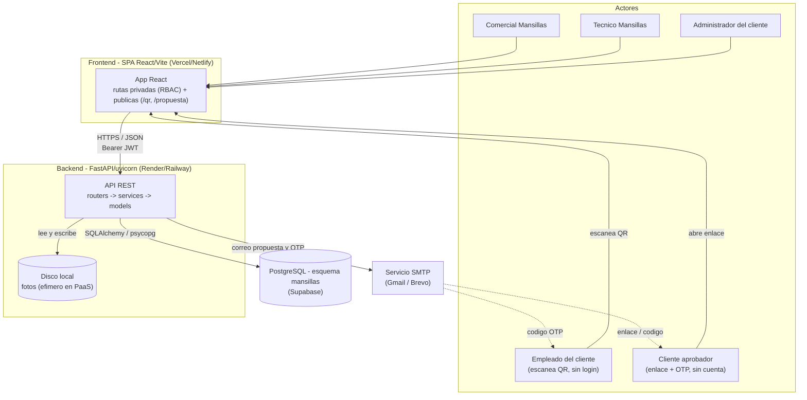
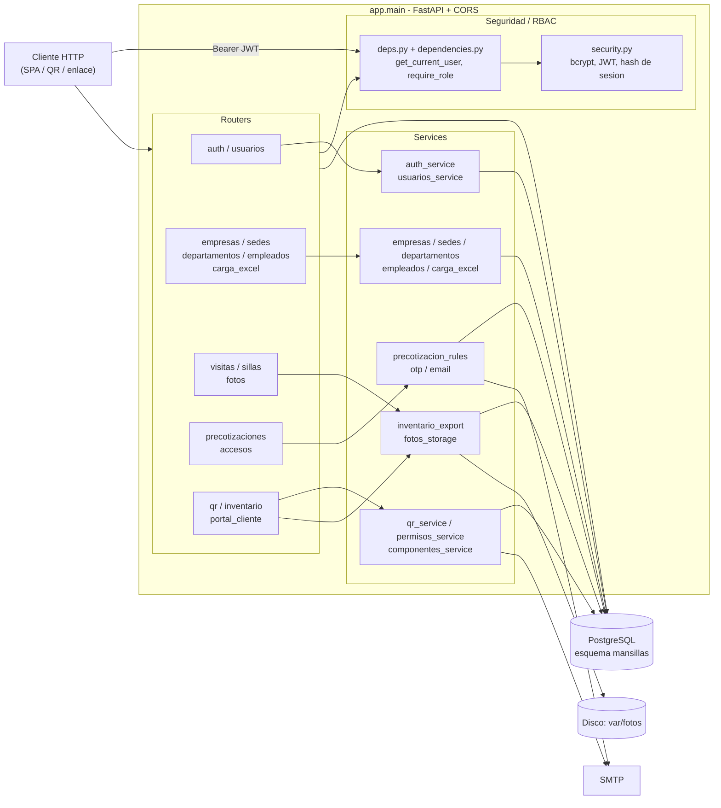
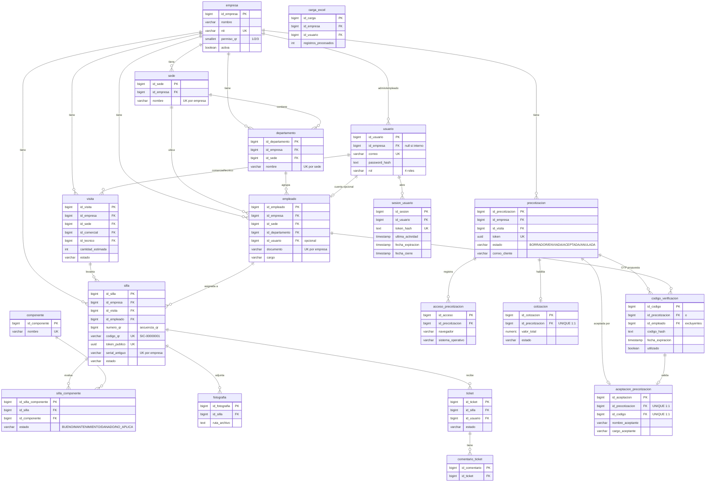
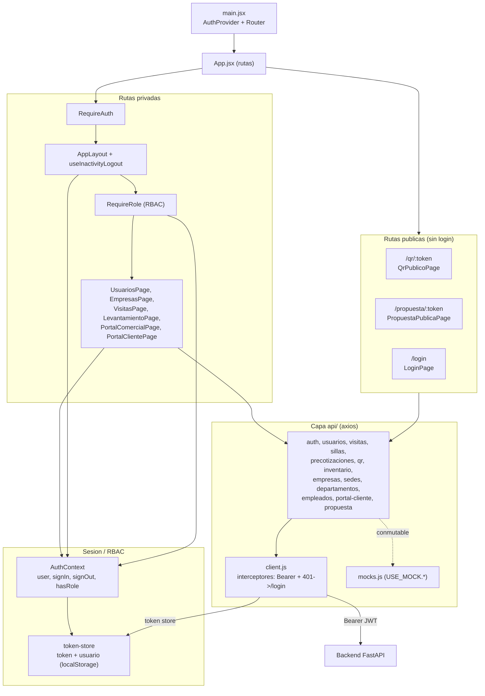
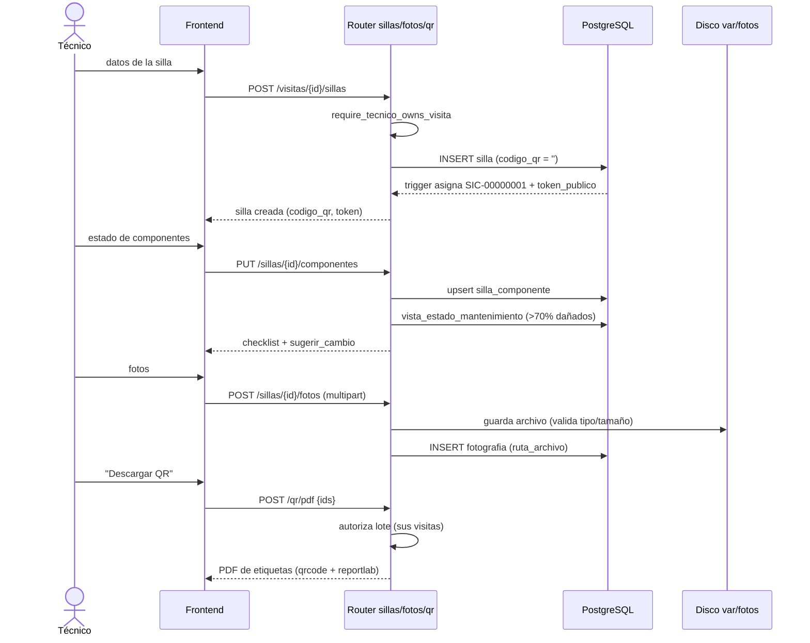
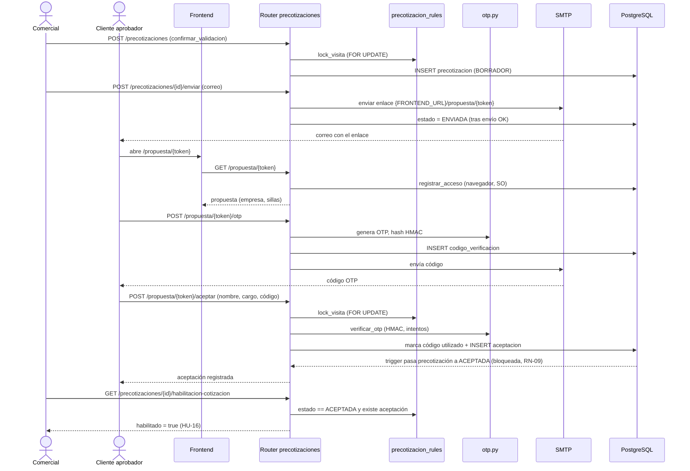
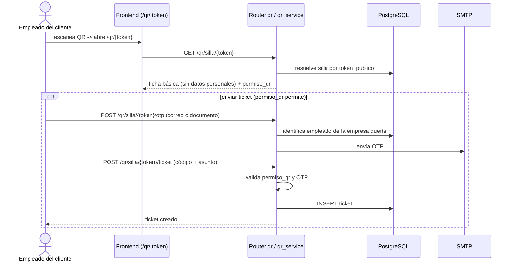

# Arquitectura de MansillasSIC

Documento de arquitectura del **Sistema de Inventarios y Cotizaciones Mansillas**
(MansillasSIC). Reúne la visión general del sistema, el stack por capa, los
diagramas de componentes del backend y del frontend, el modelo de datos y los
flujos críticos de negocio.

Este documento es la **fuente canónica de la arquitectura**. Los README del
[proyecto raíz](README.md), del [backend](backend/README.md) y del
[frontend](frontend/README.md) embeben solo los diagramas clave y enlazan aquí
para el detalle. El contexto funcional (requisitos, reglas de negocio y matriz
RBAC) vive en [`ERS_Mansillas_secciones.md`](ERS_Mansillas_secciones.md); el
despliegue, en [`DEPLOY.md`](DEPLOY.md).

---

## Tabla de contenido

1. [Visión general](#1-visión-general)
2. [Stack tecnológico por capa](#2-stack-tecnológico-por-capa)
3. [Diagrama de contexto del sistema](#3-diagrama-de-contexto-del-sistema)
4. [Actores y roles](#4-actores-y-roles)
5. [Arquitectura del backend](#5-arquitectura-del-backend)
6. [Modelo de datos](#6-modelo-de-datos)
7. [Arquitectura del frontend](#7-arquitectura-del-frontend)
8. [Flujos críticos](#8-flujos-críticos)
9. [Decisiones de diseño](#9-decisiones-de-diseño)
10. [Trazabilidad a requisitos y reglas](#10-trazabilidad-a-requisitos-y-reglas)

---

## 1. Visión general

MansillasSIC reemplaza el manejo manual del inventario de sillas (hoy en Google
Drive) por un sistema centralizado con trazabilidad por **código QR**. Cubre el
ciclo completo: el comercial programa una **visita** a una empresa cliente y
asigna un técnico; el técnico levanta en campo cada **silla** (datos básicos,
estado de 5 componentes y fotos) y descarga las etiquetas QR; el comercial
revisa el levantamiento, arma una **precotización** y la envía por correo con un
enlace único; el cliente la acepta con un código de un solo uso (OTP); y, tras
la aceptación, se habilita el módulo de cotización. Cualquier persona que
escanee el QR de una silla consulta su ficha básica sin iniciar sesión.

El sistema se compone de dos subproyectos desacoplados que se comunican por HTTP
(JSON):

- **`backend/`** — API REST en FastAPI sobre el esquema PostgreSQL `mansillas`
  (alojado en Supabase). Contiene toda la lógica de negocio, la seguridad y la
  generación de artefactos (QR en PDF, exportación CSV/XLSX, correo, OTP).
- **`frontend/`** — SPA en React + Vite que consume la API. Impone RBAC en la
  interfaz (espejo del control real del backend) y expone vistas públicas para
  el QR y la aceptación de propuestas.

### Principios de arquitectura

- **La autorización real vive en el backend.** El RBAC del frontend solo evita
  mostrar lo que no corresponde; el servidor responde `403`/`401` con
  independencia de la UI.
- **Capas delgadas en el backend.** Los *routers* traducen HTTP y aplican RBAC;
  la lógica (SQL, reglas, hashing, generación de archivos) vive en *services*.
- **La base de datos es el guardián de las invariantes.** Secuencias, `UNIQUE`,
  *checks*, FK compuestas y *triggers* imponen reglas que el backend no puede
  saltarse (códigos QR consecutivos, bloqueo de precotización aceptada,
  aislamiento empresa-recurso).
- **Ningún secreto en el código.** Todo se lee de variables de entorno
  (`backend/.env`, `VITE_*`).
- **Aislamiento multiempresa estructural.** El alcance de cada consulta se deriva
  del usuario autenticado (`empresa_id`), nunca de un identificador del request.

---

## 2. Stack tecnológico por capa

| Capa | Tecnología | Notas |
| --- | --- | --- |
| Frontend | React 19, Vite 8, react-router-dom 7, axios, xlsx | SPA estática; variables `VITE_*` incrustadas en el build |
| API | FastAPI (Starlette), Pydantic v2 | OpenAPI automático; routers por recurso |
| ORM / acceso a datos | SQLAlchemy 2.0, psycopg 3 (`postgresql+psycopg://`) | Mezcla ORM y SQL textual parametrizado |
| Base de datos | PostgreSQL 14+ (esquema `mansillas`, Supabase) | Secuencias, *triggers*, vistas, FK compuestas, `pgcrypto` |
| Seguridad | PyJWT (HS256), bcrypt, HMAC-SHA256 (OTP) | JWT + sesión persistida por hash SHA-256 del token |
| Generación de artefactos | reportlab + qrcode (PDF de QR), openpyxl (Excel), smtplib (SMTP) | — |
| Runtime / gestor | Python 3.13, `uv` | `uv sync`, `uv run` |
| Pruebas | pytest, hypothesis, httpx | Base PostgreSQL descartable recreada desde el SQL |

---

## 3. Diagrama de contexto del sistema

Despliegue previsto: frontend estático (Vercel/Netlify), backend FastAPI
(Render/Railway) y base PostgreSQL ya existente en Supabase. Todo se configura
por variables de entorno (ver [`DEPLOY.md`](DEPLOY.md)).



El origen CORS del backend deriva de `FRONTEND_URL` (más los `localhost` de
desarrollo). La URL que viaja dentro de cada QR apunta a la ruta pública del
frontend (`{FRONTEND_URL}/qr/{token_publico}`), nunca a la API.

---

## 4. Actores y roles

El sistema distingue cuatro roles con cuenta (los cuatro valores de
`usuario.rol` en el SQL) y dos actores sin cuenta que operan por enlaces con
capacidad (token público del QR, enlace de propuesta + OTP).

| Actor | ¿Autenticación? | Capacidades principales |
| --- | --- | --- |
| **COMERCIAL_MANSILLAS** | Correo + contraseña | Gestiona usuarios; programa y administra visitas; revisa y edita el levantamiento; genera/envía precotizaciones; ve accesos al enlace; consulta habilitación de cotización; inventario de todas las empresas; descarga QR |
| **TECNICO** | Correo + contraseña | Solo sus visitas asignadas: registra y edita sillas, estado de componentes y fotos; finaliza la visita; descarga QR de sus sillas |
| **ADMIN_CLIENTE** | Correo + contraseña | Solo su empresa: portal de solo lectura (sillas, componentes, fotos, precotizaciones), inventario y exportación, catálogo (sedes/departamentos/empleados), carga masiva por Excel, nivel de permiso QR |
| **EMPLEADO_CLIENTE** | No (OTP por QR) | Consulta la ficha pública de la silla; envía tickets según el `permiso_qr` de su empresa, identificándose por OTP |
| Empleado que escanea el QR | No (token público) | Consulta la ficha básica de cualquier silla (sin datos personales) |
| Cliente aprobador | No (enlace único + OTP) | Consulta y acepta la precotización desde su enlace |

La matriz RBAC completa (por módulo y funcionalidad) está en la sección 4.2.2 de
[`ERS_Mansillas_secciones.md`](ERS_Mansillas_secciones.md).

---

## 5. Arquitectura del backend

El backend sigue un patrón de **capas delgadas**: cada *router* traduce HTTP,
valida la entrada y aplica RBAC; delega la lógica en un *service*; los *services*
operan sobre los *models* (SQLAlchemy) o sobre SQL textual parametrizado contra
el esquema `mansillas`. La seguridad (JWT + sesión), el almacenamiento de fotos,
el correo/OTP y la generación de QR/Excel son colaboradores transversales.



### Routers y su responsabilidad

| Router | Prefijo | Responsabilidad |
| --- | --- | --- |
| `auth` | `/auth` | Login, sesión actual (`/me`), logout (HU-21, HU-25) |
| `usuarios` | `/usuarios` | Gestión de usuarios y roles (solo COMERCIAL, HU-20) |
| `empresas` | `/empresas` | Catálogo de empresas cliente (listar/crear) |
| `sedes` | `/empresas/{id}/sedes` | Sedes por empresa (listar/crear) |
| `departamentos` | `/sedes/{id}/departamentos` | Departamentos por sede (listar/crear) |
| `empleados` | `/empresas/{id}/empleados` | Empleados por empresa (listar/crear) |
| `carga_excel` | `/carga-masiva` | Carga masiva de empleados por `.xlsx` (HU-19) |
| `visitas` | `/visitas` | CRUD de visitas y finalización (HU-01, HU-28) |
| `sillas` | — | Registro/edición de sillas, componentes, consulta por token |
| `fotos` | — | Fotos de silla: subir, listar, servir bytes (HU-10) |
| `qr` | `/qr` | Ficha pública por QR, fotos públicas, OTP y ticket por QR, PDF de etiquetas, permiso QR por empresa |
| `inventario` | `/inventario` | Inventario con alcance por rol y exportación CSV/XLSX (HU-11) |
| `precotizaciones` | — | Levantamiento, precotización, envío, propuesta pública, OTP y aceptación, habilitación de cotización |
| `accesos` | — | Trazabilidad de accesos al enlace público (HU-14) |
| `portal_cliente` | `/portal-cliente` | Portal de solo lectura del ADMIN_CLIENTE (HU-7, R4) |

### Seguridad: dos resolutores de sesión

Existen **dos módulos de dependencias** que validan lo mismo (firma y expiración
del JWT, sesión abierta, vida máxima e inactividad) con contratos distintos:

- `app/dependencies.py` → devuelve `UsuarioPublico` (Pydantic); lo usan los
  routers de seguridad (`auth`, `usuarios`).
- `app/deps.py` → devuelve `CurrentUser` (dataclass); lo usan los routers de
  negocio (`visitas`, `sillas`, `qr`, etc.) y aporta `require_role(...)` y
  `require_tecnico_owns_visita(...)`.

Ambos resuelven el rol y la empresa **desde la tabla `usuario`**, nunca desde el
token ni desde cabeceras. El código los documenta como deuda técnica a unificar.
El flujo de sesión está en la sección 8.1.

### Generación de códigos QR y tokens: la base de datos manda

El backend **no calcula** códigos QR ni tokens. Inserta `codigo_qr = ''` y lee
el valor que la base asigna:

- `silla.numero_qr` toma el siguiente valor de la secuencia `secuencia_qr`.
- El *trigger* `trg_generar_codigo_qr` compone `codigo_qr` con formato
  `SIC-00000001` (RN-02: único y consecutivo, nunca reutilizado).
- `silla.token_publico` y `precotizacion.token` usan `gen_random_uuid()`.

---

## 6. Modelo de datos

El esquema `mansillas` (PostgreSQL) es jerárquico y usa **claves foráneas
compuestas** `(id_empresa, id_*)` para impedir cruces entre empresas (una sede,
departamento, empleado o visita siempre pertenecen a la misma empresa que la
silla que los referencia). El SQL completo vive en
[`backend/database/SQLMansillasSIC.sql`](backend/database/SQLMansillasSIC.sql).

### Diagrama entidad-relación



> El diagrama omite, por claridad, la tabla `carga_excel` en las relaciones
> (registro de auditoría de importaciones) y la secuencia `secuencia_qr`.

### Objetos activos de la base de datos

| Objeto | Tipo | Función |
| --- | --- | --- |
| `secuencia_qr` | Secuencia | Numera cada silla (`numero_qr`) de forma consecutiva e irrepetible (RN-02) |
| `generar_codigo_qr` | Trigger `BEFORE INSERT` en `silla` | Compone `codigo_qr = 'SIC-' + LPAD(numero_qr, 8)` |
| `impedir_edicion_precotizacion_aceptada` | Trigger `BEFORE UPDATE/DELETE` en `precotizacion` | Rechaza modificar o borrar una precotización `ACEPTADA` (RN-09) |
| `registrar_aceptacion_precotizacion` | Trigger `BEFORE INSERT` en `aceptacion_precotizacion` | Valida el OTP (usado, vigente, de esa precotización) y pasa la precotización de `ENVIADA` a `ACEPTADA` |
| `validar_cotizacion_tras_aceptacion` | Trigger `BEFORE INSERT/UPDATE` en `cotizacion` | Solo permite cotizar si la precotización está `ACEPTADA` (RN-10, HU-16) |
| `vista_estado_mantenimiento` | Vista | Calcula `sugerir_cambio` cuando más del 70 % de componentes aplicables están `DANADO` (RN-01) |

### Estados de las entidades

- `visita.estado`: `PROGRAMADA` → `EN_CURSO` → `FINALIZADA` / `CANCELADA`.
- `silla.estado`: `REGISTRADA`, `EN_REVISION`, `CAMBIO_SUGERIDO`, `BAJA`.
- `silla_componente.estado`: `BUENO`, `MANTENIMIENTO`, `DANADO`, `NO_APLICA`.
- `precotizacion.estado`: `BORRADOR` → `ENVIADA` → `ACEPTADA`; `ANULADA` aparte.
- `empresa.permiso_qr`: `1` solo consulta, `2` consulta y tickets, `3` tickets
  solo por el ADMIN_CLIENTE.

---

## 7. Arquitectura del frontend

La SPA organiza el código en **páginas** (una por vista de negocio),
**componentes** reutilizables, una capa **`api/`** que encapsula todas las
llamadas HTTP, y **`auth/` + `context/`** para la sesión y el RBAC de interfaz.
El enrutado (`App.jsx`) separa las rutas públicas (QR y propuesta) de las
privadas, que van detrás de `RequireAuth` y, cuando aplica, de `RequireRole`.



### Piezas clave

- **`AuthContext` / `useAuth`**: mantiene `user` (con rol), rehidrata la sesión
  desde `localStorage` al arrancar, y expone `signIn`, `signOut` y `hasRole`.
- **`RequireAuth`**: redirige a `/login` si no hay sesión.
- **`RequireRole`**: muestra "Acceso denegado" si el rol no está permitido. Es el
  espejo del `403` del backend; la autorización real la impone el servidor.
- **`useInactivityLogout`**: cierra sesión tras `VITE_INACTIVITY_MINUTES` (30 por
  defecto) sin actividad, en coherencia con `SESSION_INACTIVITY_MINUTES` del
  backend. Es solo UX: el backend ya expira la sesión y responde `401`.
- **`api/client.js`**: instancia axios con dos interceptores — adjunta el JWT
  como `Authorization: Bearer` y, ante un `401` que no venga de `/auth/login`,
  limpia la sesión y redirige a `/login`.
- **`mocks.js`**: bandera `USE_MOCK.<recurso>` por recurso. Permite desarrollar
  pantallas contra datos simulados y, cuando el endpoint real existe, poner la
  bandera en `false` sin tocar la pantalla. **Estado actual: todas las banderas
  están en `false`** (todos los recursos consumen el backend real).

### Mapa de rutas ↔ roles

| Ruta | Página | Acceso |
| --- | --- | --- |
| `/login` | `LoginPage` | Público |
| `/qr/:token` | `QrPublicoPage` | Público (token del QR) |
| `/propuesta/:token` | `PropuestaPublicaPage` | Público (enlace + OTP) |
| `/` | `HomeRedirect` | Autenticado (redirige según rol) |
| `/usuarios` | `UsuariosPage` | COMERCIAL_MANSILLAS |
| `/empresas` | `EmpresasPage` | COMERCIAL_MANSILLAS |
| `/visitas` | `VisitasPage` | COMERCIAL, TECNICO, ADMIN_CLIENTE |
| `/levantamiento` | `LevantamientoPage` | TECNICO, COMERCIAL |
| `/comercial` | `PortalComercialPage` | COMERCIAL_MANSILLAS |
| `/cliente` | `PortalClientePage` | ADMIN_CLIENTE |

---

## 8. Flujos críticos

### 8.1. Login, sesión e inactividad (HU-21, HU-25)

El token nunca se guarda en claro en el servidor: se persiste solo su
`SHA-256` en `sesion_usuario`, lo que permite revocarlo (logout) y cerrarlo por
inactividad o por vida máxima.

```mermaid
sequenceDiagram
    actor U as Usuario
    participant F as Frontend (axios)
    participant A as auth / auth_service
    participant S as security.py
    participant DB as PostgreSQL

    U->>F: correo + contraseña
    F->>A: POST /auth/login
    A->>DB: SELECT usuario por correo
    A->>S: verify_password (bcrypt)
    Note over A: usuario activo y rol habilitado
    A->>S: create_access_token (JWT, exp absoluta)
    A->>DB: INSERT sesion_usuario (token_hash = SHA-256)
    A-->>F: access_token + usuario
    F->>F: guarda token + usuario; arranca temporizador

    U->>F: petición autenticada
    F->>A: Authorization: Bearer <jwt>
    A->>S: decode_access_token (firma, exp)
    A->>DB: busca token_hash, sesión abierta
    alt expirada o inactiva
        A->>DB: UPDATE fecha_cierre
        A-->>F: 401 (sesión cerrada)
        F->>F: limpia sesión, redirige /login
    else válida
        A->>DB: UPDATE ultima_actividad
        A-->>F: 200 (recurso)
    end
```

### 8.2. Levantamiento de silla y QR (HU-02 a HU-10, HU-28)

El técnico registra la silla, su checklist de 5 componentes y fotos; la base
asigna el número y el código QR. El PDF de etiquetas lo compone `reportlab`.



### 8.3. Precotización: envío, aceptación por OTP y habilitación (HU-12 a HU-16)



### 8.4. Acceso público por QR (HU-17, HU-24)



---

## 9. Decisiones de diseño

- **Capas delgadas (routers → services).** Mantiene los routers enfocados en
  HTTP y RBAC, y permite reutilizar reglas (p. ej. `precotizacion_rules`) entre
  routers sin importaciones circulares.
- **Invariantes en la base de datos.** Secuencia + *trigger* para el QR, FK
  compuestas para el aislamiento multiempresa, y *triggers* para bloquear la
  precotización aceptada y para habilitar la cotización. El backend valida
  además en su capa, pero la base es la última línea de defensa.
- **Sesión por hash del token.** Permite revocación (logout) y cierre por
  inactividad/vida máxima sin almacenar el token en claro; el `jti` aleatorio
  evita colisiones de hash entre tokens del mismo usuario.
- **OTP con HMAC e independiente del JWT.** `OTP_SECRET` separado de
  `JWT_SECRET`; solo se guarda `v1$nonce$hmac`, nunca el código. El control de
  abuso es en memoria (documentado como no apto por sí solo para producción
  pública de alto tráfico).
- **Candado sobre la fila `visita` (`FOR UPDATE`).** Punto único de coordinación
  para crear/editar/enviar/aceptar la precotización, evitando duplicados
  concurrentes sin un `UNIQUE` que no podría existir antes de crear la fila.
- **Fotos en disco local.** Simplicidad para el MVP; `ruta_archivo` guarda solo
  la ruta relativa. **Limitación conocida**: en PaaS con disco efímero las fotos
  se pierden al reiniciar (ver [`DEPLOY.md`](DEPLOY.md), sección 4).
- **RBAC duplicado (frontend + backend) a propósito.** El frontend oculta lo que
  no corresponde para mejorar la UX; el backend es la única autoridad real.
- **Mocks conmutables en el frontend.** Permitieron avanzar en paralelo mientras
  el backend crecía; hoy todas las banderas están en `false`.

### Deuda técnica reconocida

- Unificar `app/deps.py` y `app/dependencies.py` (dos resolutores de sesión con
  contratos distintos).
- Migrar las fotos a almacenamiento persistente (p. ej. Supabase Storage) para
  entornos con disco efímero.
- El documento [`frontend/docs/INTEGRACION_ENDPOINTS.md`](frontend/docs/INTEGRACION_ENDPOINTS.md)
  refleja un estado intermedio de integración anterior al estado actual (en el
  que todos los recursos ya consumen endpoints reales).

---

## 10. Trazabilidad a requisitos y reglas

| Requisito / Regla | Dónde se implementa |
| --- | --- |
| RF-01 / RN-05 Asignar visitas (solo comercial) | `routers/visitas.py` (`ComercialUser`) |
| RF-02 / RN-04 Sillas pueden superar lo estimado | `visitas.py` (`cantidad_estimada` nunca se reescribe) |
| RF-03 / RN-02 QR único y consecutivo | `secuencia_qr` + trigger `generar_codigo_qr` |
| RF-04 / RN-03 Serial antiguo único por empresa | `silla UNIQUE (id_empresa, serial_antiguo)` |
| RF-05 Descarga de QR para impresión | `routers/qr.py` `POST /qr/pdf` (reportlab) |
| RF-08 / RN-18 Checklist de componentes | `silla_componente` + `componentes_service` |
| RF-09 / RN-01 Sugerir cambio >70% | `vista_estado_mantenimiento` |
| RF-10 Fotografías por silla | `routers/fotos.py` + `fotos_storage` |
| RF-11 Inventario y exportación CSV/XLSX | `routers/inventario.py` + `inventario_export_service` |
| RF-13 / RN-07 Enlace único por precotización | `precotizacion.token` (`gen_random_uuid`) |
| RF-14 Trazabilidad de accesos | `routers/accesos.py` + `acceso_precotizacion` |
| RF-15 / RN-08/09 Aceptación por OTP y bloqueo | `precotizaciones.py` + `otp.py` + triggers |
| RF-16 / RN-10 Habilitar cotización tras aceptación | `precotizacion_rules.estado_habilitacion_cotizacion` |
| RF-17 Ficha pública por QR | `routers/qr.py` `GET /qr/silla/{token}` |
| RF-18 / RN-12 Nivel de permiso QR por empresa | `empresa.permiso_qr` + `permisos_service` |
| RF-19 Carga masiva por Excel | `routers/carga_excel.py` + `carga_excel_service` |
| RF-20/21/22 Roles, login y RBAC | `auth`, `deps`, `dependencies`, `security` |
| RF-23 / RN-13 Aislamiento multiempresa | FK compuestas + alcance por `empresa_id` |
| RF-25 / HU-25 Logout e inactividad | `auth_service.logout`, resolución de sesión, `useInactivityLogout` |
| RF-26/27/28 Catálogo organizacional | `empresas`, `sedes`, `departamentos`, `empleados` |
