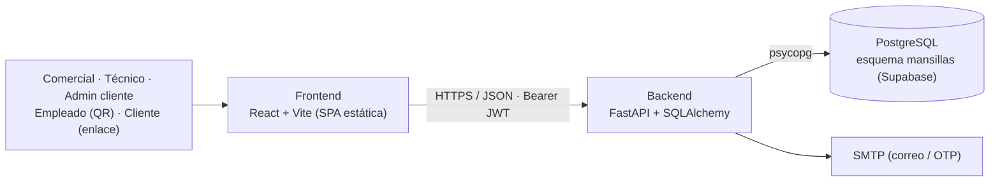

# MansillasSIC — Sistema de Inventarios y Cotizaciones

Sistema web para la empresa **Mansillas** que centraliza el inventario de sillas
y el ciclo de precotización con sus clientes, dando trazabilidad a cada silla
mediante un **código QR**. Sustituye el manejo manual del inventario (hasta ahora
en Google Drive) por una aplicación con control de accesos por rol, levantamiento
en campo, generación y descarga de etiquetas QR, y aceptación de propuestas por
el cliente con un código de verificación.

Proyecto desarrollado bajo modalidad **universidad-empresa** (Universidad
Distrital Francisco José de Caldas, Ingeniería de Requerimientos). El alcance,
los requisitos (RF), las reglas de negocio (RN) y la matriz RBAC están en
[`ERS_Mansillas_secciones.md`](ERS_Mansillas_secciones.md).

## Qué hace

- **Levantamiento de inventario.** El técnico registra cada silla (empresa, sede,
  departamento, empleado, cargo, serial antiguo), evalúa el estado de 5
  componentes y adjunta fotos. La base asigna un QR único y consecutivo.
- **Códigos QR.** Descarga de etiquetas en PDF para impresión externa; cada QR
  lleva una URL pública que muestra la ficha básica de la silla sin login.
- **Inventario y exportación.** Consulta del inventario con alcance por rol y
  exportación a CSV/XLSX.
- **Precotizaciones.** El comercial revisa el levantamiento, crea la
  precotización y la envía por correo con un enlace único; el cliente la acepta
  con un código de un solo uso (OTP) y la propuesta queda bloqueada.
- **Catálogo organizacional.** Alta de empresas, sedes, departamentos y
  empleados, con carga masiva de empleados por Excel.
- **Control de acceso.** Cuatro roles con cuenta y dos actores sin cuenta
  (empleado por QR, cliente aprobador por enlace), con aislamiento entre
  empresas cliente.

## Arquitectura



El sistema tiene dos subproyectos desacoplados que se comunican por HTTP:

| Subproyecto | Carpeta | Stack | Documentación |
| --- | --- | --- | --- |
| Backend (API REST) | [`backend/`](backend/README.md) | FastAPI, SQLAlchemy 2.0, psycopg 3, PostgreSQL | [`backend/README.md`](backend/README.md) |
| Frontend (SPA) | [`frontend/`](frontend/README.md) | React 19, Vite 8, react-router-dom 7 | [`frontend/README.md`](frontend/README.md) |

La descripción completa (componentes, modelo de datos ER y flujos de secuencia)
está en [`ARCHITECTURE.md`](ARCHITECTURE.md).

## Roles y módulos

| Rol | Acceso principal |
| --- | --- |
| **Comercial Mansillas** | Usuarios, visitas, revisión del levantamiento, precotizaciones, inventario de todas las empresas, descarga de QR |
| **Técnico Mansillas** | Levantamiento en campo de sus visitas asignadas, componentes, fotos, QR |
| **Administrador del cliente** | Portal de solo lectura de su empresa, catálogo (sedes/departamentos/empleados), carga masiva, nivel de permiso QR |
| **Empleado del cliente** | Ficha pública por QR y, según el permiso de su empresa, envío de tickets (identificándose por OTP) |
| **Cliente aprobador** | Consulta y aceptación de la precotización desde su enlace único (sin cuenta) |

## Arranque rápido (extremo a extremo)

Requisitos: Python 3.13 + [uv](https://docs.astral.sh/uv/), Node.js 20+ y una
base PostgreSQL (local o Supabase).

**1. Base de datos.** Aplica el esquema sobre tu base:

```bash
psql "<DATABASE_URL>" -f backend/database/SQLMansillasSIC.sql
```

**2. Backend.**

```bash
cd backend
uv sync
cp .env.example .env            # completa DATABASE_URL, JWT_SECRET, FRONTEND_URL, OTP_SECRET
uv run python scripts/create_user.py \
    --nombre "Comercial" --correo comercial@mansillas.com \
    --password "Secreta123" --rol COMERCIAL_MANSILLAS
uv run uvicorn app.main:app --reload
```

El API queda en `http://127.0.0.1:8000` (documentación interactiva en `/docs`,
sonda de salud en `/health`).

**3. Frontend.**

```bash
cd frontend
npm ci
cp .env.example .env.local      # VITE_API_URL=http://127.0.0.1:8000
npm run dev
```

La aplicación queda en `http://localhost:5173`.

> Las instrucciones detalladas de cada parte están en sus README; la guía de
> despliegue a producción, en [`DEPLOY.md`](DEPLOY.md).

## Índice de documentación

| Documento | Contenido |
| --- | --- |
| [`ARCHITECTURE.md`](ARCHITECTURE.md) | Arquitectura, diagramas, modelo de datos y flujos |
| [`backend/README.md`](backend/README.md) | API, endpoints, configuración, pruebas |
| [`frontend/README.md`](frontend/README.md) | SPA, rutas, RBAC de interfaz, scripts |
| [`DEPLOY.md`](DEPLOY.md) | Despliegue del backend, el frontend y notas de la base |
| [`ERS_Mansillas_secciones.md`](ERS_Mansillas_secciones.md) | Especificación de requisitos (RF/RN/RBAC) |
| [`frontend/docs/INTEGRACION_ENDPOINTS.md`](frontend/docs/INTEGRACION_ENDPOINTS.md) | Seguimiento histórico de la integración frontend ↔ backend |

## Limitaciones conocidas

- **Fotos en disco efímero.** Las fotos de las sillas se guardan en el disco
  local del backend (`var/fotos`). En plataformas PaaS con disco efímero (planes
  gratuitos de Render/Railway) se pierden al reiniciar o redeploy. El resto de
  los datos vive en Supabase y sí persiste. Ver [`DEPLOY.md`](DEPLOY.md),
  sección 4.
- **Control de abuso del OTP en memoria.** No persiste entre reinicios ni se
  comparte entre procesos; suficiente para el MVP, no para producción pública de
  alto tráfico.
- **Dos resolutores de sesión** en el backend (`app/deps.py` y
  `app/dependencies.py`), pendientes de unificar.

## Trabajo futuro

Fuera del alcance actual, previsto por el ERS: generación automática de precios
en la cotización, pasarela de pagos, modelo SaaS para terceros, integración con
otros sistemas de la empresa y migración del almacenamiento de fotos a un
servicio persistente (p. ej. Supabase Storage).
