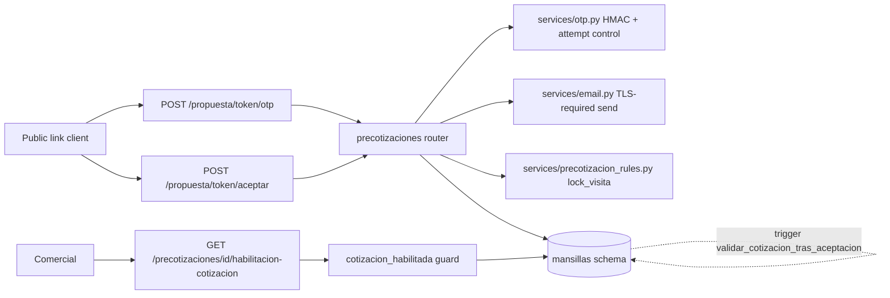

# Design Document

## Overview

This feature adds OTP-based acceptance of a pre-quotation through its public link (HU-15) and gates quotation operations behind that acceptance (HU-16), on the existing FastAPI + SQLAlchemy backend with no schema change. It reuses the public proposal endpoint, the SMTP helper, the shared Visit-lock/consistency rules, the access log, and the database acceptance/quotation triggers. OTP codes are generated with `secrets`, stored only as an HMAC-SHA256 keyed by an independent `OTP_SECRET`, and consumed in a single transaction so the existing trigger performs the `ENVIADA → ACEPTADA` transition.

## Architecture



## Existing functionality reused
- `GET /propuesta/{token}` and the `Precotizacion` model; `token`, `estado`, `correo_cliente`, `fecha_aceptacion`.
- `app/services/email.py` (extended with an optional TLS-required mode), `app/services/precotizacion_rules.py` (`lock_visita`), `app/deps.py`, `registrar_acceso`.
- DB guarantees: `registrar_aceptacion_precotizacion` (ENVIADA→ACEPTADA), `impedir_edicion_precotizacion_aceptada`, `validar_cotizacion_tras_aceptacion`; `aceptacion_precotizacion.id_precotizacion`/`id_codigo` UNIQUE.

## Module / File Structure

```
backend/app/
├── config.py                         # MODIFY: OTP settings (OTP_SECRET, length/expiry/interval/attempts)
├── models/
│   ├── __init__.py                   # MODIFY: export the two new models
│   ├── codigo_verificacion.py        # NEW: maps existing codigo_verificacion
│   └── aceptacion_precotizacion.py   # NEW: maps existing aceptacion_precotizacion
├── services/
│   ├── otp.py                        # NEW: generate/hash/verify OTP + in-memory abuse control
│   └── email.py                      # MODIFY: optional exigir_tls parameter (backward compatible)
└── routers/
    └── precotizaciones.py            # MODIFY: /otp, /aceptar, /habilitacion-cotizacion + guard
```

No new router or service layer beyond `otp.py`; no `cotizacion` model (not needed for HU-16 enablement). No ORM table creation, no migrations.

## Data Models (existing tables, no schema change)

Verified against `database/SQLMansillasSIC.sql`.

**`codigo_verificacion`** → `CodigoVerificacion`:
`id_codigo` (identity PK, `FetchedValue`), `id_precotizacion` (BIGINT, nullable per CHECK), `id_empleado` (nullable), `correo_destino` (VARCHAR(150) NOT NULL), `codigo_hash` (TEXT NOT NULL), `fecha_expiracion` (TIMESTAMP NOT NULL), `utilizado` (BOOL NOT NULL, default FALSE). CHECK: exactly one of `id_precotizacion`/`id_empleado` — this feature always sets `id_precotizacion` and leaves `id_empleado` NULL.

**`aceptacion_precotizacion`** → `AceptacionPrecotizacion`:
`id_aceptacion` (identity PK, `FetchedValue`), `id_precotizacion` (BIGINT NOT NULL **UNIQUE**), `id_codigo` (BIGINT NOT NULL **UNIQUE**), `nombre_aceptante` (VARCHAR(150) NOT NULL), `cargo_aceptante` (VARCHAR(100) NOT NULL), `correo_aceptante` (VARCHAR(150) NOT NULL), `fecha_aceptacion` (TIMESTAMP NOT NULL, default `CURRENT_TIMESTAMP` → `FetchedValue`).

## Components and Interfaces

| Method | Path | Role | Request | Response |
|--------|------|------|---------|----------|
| POST | `/propuesta/{token}/otp` | public | — | `202` `{detalle}` (no OTP/hash); `404`; `429` (too soon); `503` (SMTP not configured/TLS); `502` (send failure) |
| POST | `/propuesta/{token}/aceptar` | public | `{nombre_aceptante, cargo_aceptante, codigo}` | `200` `AceptacionOut`; `400` (bad code format); `404`; `409` (not ENVIADA / already accepted); `422` (bad fields); `429` (too many attempts) |
| GET | `/precotizaciones/{id_precotizacion}/habilitacion-cotizacion` | COMERCIAL | — | `200` `{habilitado: bool, estado}`; `401`; `403`; `404` |

All public responses set `Cache-Control: no-store`, including error responses.

**Schemas (explicit):**
- `OtpResponse`: `{detalle: str}` — a neutral message; never the OTP, hash, email, or internal state.
- `AceptarRequest`: `{nombre_aceptante: str (1..150), cargo_aceptante: str (1..100), codigo: str}`. `codigo` is a **string** (preserves leading zeros), validated as exactly 6 digits.
- `AceptacionOut`: `{estado: str, fecha_aceptacion: datetime}` — minimal confirmation. No OTP, no internal ids beyond what is needed.
- `HabilitacionOut`: `{habilitado: bool, estado: str}`.

**Error-echo safety:** FastAPI/Pydantic validation can fail BEFORE the handler runs and its 422 body can echo the input (e.g. `codigo` sent as a number, missing fields, wrong types, invalid JSON body, extra fields). The acceptance endpoint must therefore sanitize these locally (accept `codigo` as a free string and validate shape inside the handler, return a generic `400`/`429` for OTP problems) so the submitted code is never reflected back and never logged. The global FastAPI error handling is NOT modified, and the endpoint is NOT implemented in this block — this is a design constraint for Block 3.

## Cryptographic strategy (OTP)

- **Generation**: `secrets.randbelow(10**6)` zero-padded to 6 digits (string), preserving leading zeros; ASCII digits only.
- **Issuance nonce (avoids a circular dependency with `id_codigo`)**: a per-issuance random nonce from `secrets.token_hex` is generated at hashing time, so the HMAC does not need the DB-assigned `id_codigo`. The nonce is NOT a secret.
- **Hashing**: `hmac.new(OTP_SECRET, msg, sha256)` where `msg` unambiguously binds the pre-quotation id, the issuance nonce, and the code (length-prefixed / delimited to avoid ambiguity). `codigo_hash` stores a **versioned** representation `v1$nonce$hmac_hex`.
- **Verification**: parse the stored `v1$nonce$hmac`, recompute the HMAC over `(id_precotizacion, nonce, submitted_code)`, and compare with `hmac.compare_digest`. A malformed stored representation is rejected with a controlled error.
- **Secret**: `OTP_SECRET` is independent (never `JWT_SECRET`), read from env. The app starts without it, but `otp.py` raises a controlled error (surfaced as `503`) on any OTP operation when it is missing/insecure.
- The plain OTP exists only transiently to email it; it is never stored or logged.

## Attempt / request control (in-memory, documented limits)

The schema has no attempt/request-count columns, and `fecha_expiracion` is NOT the issuance time (invalidation rewrites it), so issue times must not be derived from it. The simplest schema-free approach, all in memory:
- **Request throttle**: minimum 60 s between OTP requests per pre-quotation.
- **Cumulative request limit** (MVP technical decision): max 5 requests per pre-quotation in a 1-hour window.
- **Failed attempts per issuance**: max 5, keyed by `(id_precotizacion, issuance-nonce)`.
- **Cumulative failed-attempt limit** (MVP technical decision): max 15 per pre-quotation in a 1-hour window; it does NOT reset when a new code is issued.
- A single in-memory store guarded by `threading.Lock`; check-and-update are atomic where needed; counters per pre-quotation and per issuance; cumulative windows survive re-issuance; expired entries are purged on access; a documented maximum capacity. Current (non-expired) counters are never evicted to admit new entries; when at capacity with nothing to free, new operations are rejected in a controlled way. Intervals/windows use a **monotonic** clock (`time.monotonic`), with an injectable time source for deterministic tests (no real sleeps).
- **Documented limitation**: this state is non-persistent, lost on restart, not shared across processes/instances, and is NOT sufficient protection for public production; requesting a new OTP cannot reset the cumulative limits.
- No new table/column, no Redis, no external service, no dependency.

## SMTP extension (TLS-required for OTP)

`enviar_correo(destinatario, asunto, cuerpo, *, exigir_tls=False)`: backward compatible. When `exigir_tls=True` (OTP sends), a non-TLS configuration (`smtp_tls` false) raises `EmailNoConfigurado` (controlled), so an OTP is never sent over clear text even without credentials. Existing callers are unaffected.

## Transactional sequences

**OTP request (`POST /propuesta/{token}/otp`):**
1. Resolve the pre-quotation by `token` (malformed/unknown → `404`, indistinguishable).
2. `lock_visita` on the pre-quotation's visit (consistent lock order).
3. Re-read the pre-quotation `estado`/`correo_cliente`; only `ENVIADA` continues (else `404`).
4. Apply request throttling (`429` if too soon) and verify a stored `correo_cliente` exists.
5. Generate the OTP and its HMAC.
6. Expire previous unused codes for the pre-quotation by rewriting `fecha_expiracion` to a strictly-past value on the PostgreSQL clock (`clock_timestamp() - make_interval(secs=1)`), so a code whose expiry would otherwise equal the current instant is not counted as valid by the `fecha_expiracion >= clock_timestamp()` test.
7. Insert the new `codigo_verificacion` with `codigo_hash = v1$nonce$hmac` (the HMAC uses the issuance nonce, so no `id_codigo` is needed first), `utilizado=FALSE`, `correo_destino = correo_cliente`, and `fecha_expiracion = func.clock_timestamp() + make_interval(mins=OTP_TTL_MINUTES)` on the **PostgreSQL clock** (`clock_timestamp()`, the real wall clock, consistent with the acceptance trigger's `CURRENT_TIMESTAMP` and avoiding naive/aware/UTC/local mixing). The invalidation of previous codes and the insert of the new one share the same clock source, so re-issuance always leaves exactly one non-expired code. Then send the email with `exigir_tls=True`. The request throttle is counted BEFORE the SMTP call (provisional policy) so a provider failure cannot enable unlimited requests.
8. Commit/rollback: the expiry of previous codes and the insert of the new code are in the **same transaction**, so a rollback reverts BOTH. Policy:
   - SMTP ok + commit ok → previous codes stay expired, the new code is valid.
   - SMTP fails → full rollback: the new code is not persisted and the previous codes recover their prior state (still usable only if still valid and with attempts remaining) → `502`/`503`.
   - SMTP ok + commit fails → log the incident without exposing secrets; do NOT claim the email can be reverted.
   No intermediate commit; no atomicity between SMTP and PostgreSQL is claimed.

**Acceptance (`POST /propuesta/{token}/aceptar`):**
1. Resolve the pre-quotation by `token` (→ `404`).
2. `lock_visita` on its visit (existing protocol / consistent order).
3. Re-read the pre-quotation; require `ENVIADA` (else `409`).
4. Select strictly the **most recent** code of the pre-quotation (`id_empleado` NULL, highest `id_codigo`) `FOR UPDATE`; an earlier issuance never becomes acceptable. Then re-check validity on the actual wall clock (`clock_timestamp()`, after the lock): not used, not expired, `correo_destino == correo_cliente`. Invalid → generic `400`.
5. Parse the issuance nonce (a malformed stored hash → `500` internal inconsistency, NOT counted as a client attempt). Check attempt limits (per-issuance 5, cumulative 15) → `429`; verify HMAC with `compare_digest`. On a wrong code → record the failed attempt (in memory; reaching abuse capacity also → `429`), rollback, return generic `400`. Nothing is consumed/inserted/transitioned.
6. The whole acceptance from here is one protected unit: mark the code `utilizado = TRUE`.
7. **`db.flush()`** so the trigger sees the consumed code when the insert fires.
8. Insert `aceptacion_precotizacion` (`correo_aceptante = stored correo_cliente`); the `BEFORE INSERT` trigger validates (`utilizado=TRUE`, not expired, linked) and transitions `ENVIADA → ACEPTADA`.
9. Let the trigger set `ACEPTADA` (never set it manually). After the insert flush, verify the row shows `estado == 'ACEPTADA'` and a non-null `fecha_aceptacion` before committing; capture `estado`/`fecha` for the response (no post-commit ORM read).
10. Single `commit`. An `IntegrityError` is mapped to `409` ONLY when it names the known UNIQUE constraints (`id_precotizacion`/`id_codigo`/`aceptacion_precotizacion`); any other integrity error → `500`. A `DBAPIError` on commit distinguishes a confirmed failure from an uncertain outcome (`connection_invalidated`) and does NOT claim the acceptance never happened. The failed-attempt counter lives in memory, so it survives the DB rollback. Consistent lock order; one transaction, no intermediate commit (account for SQLAlchemy autobegin).

The endpoint handler is a synchronous `def` (FastAPI runs it in a worker thread with its own Session, so blocking SQLAlchemy does not stall the event loop and no Session is shared across threads); the request body is read by an async dependency bounded to 4 KB before buffering.

## Quotation enablement guard (HU-16)

`cotizacion_habilitada(db, id_precotizacion) -> bool`: true only if the pre-quotation exists, `estado == 'ACEPTADA'`, and an `aceptacion_precotizacion` row exists for it. Used by `GET /precotizaciones/{id}/habilitacion-cotizacion` (consult) and intended to be required by future quotation operations (enforce). Distinction: the endpoint **consults** enablement; real quotation operations must **require** it. No quotation endpoints exist yet, so the enforce-side integration is a recorded dependency; the module is NOT claimed protected until those operations call the guard. No quotation is created on acceptance; the DB trigger already blocks quotations before acceptance.

## Error handling and security

| Condition | Status |
|-----------|--------|
| Malformed/unknown token, non-`ENVIADA` for OTP, unknown pre-quotation | `404` (indistinguishable where public) |
| OTP requested too soon | `429` |
| Bad `codigo` format / fields | `400` / `422` (no echo of the code) |
| Wrong/expired/used/foreign OTP, attempts exceeded | `400` / `429` generic |
| Not `ENVIADA` at acceptance / already accepted | `409` |
| SMTP not configured or TLS unavailable for OTP | `503` |
| SMTP send failure | `502` |
| Enablement by wrong role | `403`; unauthenticated `401` |

No OTP/hash/secret is ever returned or logged. Public responses are `Cache-Control: no-store`. Internal commercial authorization follows the existing policy (any visit).

## Testing Strategy

Unit (isolated, no DB/SMTP, runnable standalone):
- OTP generation and 6-digit format; leading-zero preservation; HMAC + `compare_digest`; missing/insecure `OTP_SECRET` → controlled error; expiry logic; attempt/request limits and in-memory cleanup/thread safety; `exigir_tls` forces TLS even without credentials; no OTP in error outputs/logs.

Integration (pending an isolated PostgreSQL):
- OTP request ok; unknown/invalid token; non-allowed states; authorized recipient only; previous-code invalidation; SMTP failure; acceptance with wrong/expired/used/foreign code; successful acceptance via the real trigger; persistence of nombre/cargo/correo/fecha; rollback on acceptance-insert failure; duplicate-acceptance prevention; concurrent requests with independent connections; enablement across all states; `ACEPTADA` without an acceptance record; auth/authorization of the enablement endpoint.
- Sequential tests are not presented as concurrency proofs. `conftest.py` is not modified.

## Traceability

| Requirement | Design element |
|-------------|----------------|
| R1 request OTP | `POST /propuesta/{token}/otp`; `otp.py`; email `exigir_tls` |
| R2 accept with OTP | `POST /propuesta/{token}/aceptar`; transactional sequence; trigger transition |
| R3 OTP security | `otp.py` HMAC-SHA256 + `OTP_SECRET`; fixed MVP params; in-memory limits + documented limitation |
| R4 enablement (HU-16) | `cotizacion_habilitada` guard + `GET .../habilitacion-cotizacion` |
| R5 reuse | existing models/services/deps/triggers; no schema change; no extra infra |
| R6 consistency | three immutability levels; unguarded routes recorded as blocking dependency |

## Pending decisions and dependencies
- Accepted-content consistency (unguarded routes: additional registration, technician edit, components, photos) — blocking for definitive HU-15 acceptance.
- Real SMTP account; final public route paths with Nicolás; proposal content (HU-08/HU-09); guard integration with real quotation endpoints; persistent OTP limits (needs schema change, not applied).
- BUG-A05 (SCRUM-54), BUG-A06 (OTP rejection criteria), CR-01 (SCRUM-65): open unknowns, not assumed resolved.
- Integration tests pending an isolated PostgreSQL.
