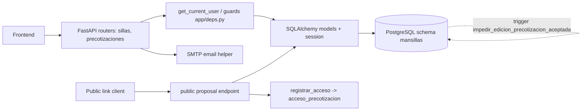

# Design Document

## Overview

This feature adds pre-quotation management on top of the existing Mansillas SIC backend, with no schema change and no new architectural layers. It covers:

- **HU-12** — the Comercial consults and edits the survey (the chairs of a visit), validates it, and the validated survey backs the pre-quotation.
- **HU-13** — the Comercial creates a pre-quotation in `BORRADOR`, sends a unique token-based link to the client's email (`ENVIADA`), and the client consults the proposal through that public link, whose access is logged.

Acceptance by OTP (HU-15) and the quotation module (HU-16) are out of scope. The component checklist and `sugerir_cambio` (Esteban) are not implemented; only read if present.

### Validation model (chosen)
Validation and pre-quotation creation are a **single explicit action**: `POST /precotizaciones` requires `confirmar_validacion: true`, which both confirms the current survey and creates the `BORRADOR` pre-quotation. This removes the earlier circular dependency (Requirement 3 of HU-12 vs. Requirement 4 of HU-12) and needs no schema change. "Validated" is defined per state: `BORRADOR` = confirmed at creation, still correctable; `ENVIADA`/`ACEPTADA` = confirmed survey frozen for the proposal; `ANULADA` = void. The existence of a pre-quotation is not, by itself, proof that a later survey edit was validated: a fresh explicit confirmation is required before sending. A standalone/persistent or per-version validation state is **not** representable without a schema change; that limitation and a minimal change are recorded under Pending decisions, not applied.

## Architecture

Same request flow as the rest of the backend: router → `get_current_user` + role/ownership guard (`app/deps.py`) → SQLAlchemy session (`get_db`) → existing `mansillas` tables. Two additions: an SMTP email helper (thin, configured by env vars) and a public, unauthenticated proposal endpoint that logs access through the existing `registrar_acceso`.



## Existing functionality reused

- `Precotizacion` model (`app/models/precotizacion.py`): `token`, `estado`, `correo_cliente`, `fecha_envio`, `creada_por`, `observaciones`, `id_empresa`, `id_visita`. `token` and `fecha_creacion` are `FetchedValue()`.
- `GET /sillas?id_visita=` and `SillaOut` (HU-02); chair photographs (HU-10) as survey content.
- `registrar_acceso(db, precotizacion_id, user_agent)` and `GET /precotizaciones/{id}/accesos` (`app/routers/accesos.py`).
- RBAC in `app/deps.py`; `settings.frontend_url`; the `{FRONTEND_URL}/...token...` link pattern already used by QR.
- DB guarantees: `token` default `gen_random_uuid()` UNIQUE; trigger `impedir_edicion_precotizacion_aceptada`; `UNIQUE (id_empresa, id_visita)`.

## Module / File Structure

```
backend/app/
├── main.py                 # MODIFY: include the precotizaciones router
├── config.py               # MODIFY: add SMTP settings (host, port, user, password, from, tls, timeout) + proposal path
├── routers/
│   ├── sillas.py           # MODIFY: add PUT /sillas/{id}/comercial (commercial survey edit)
│   └── precotizaciones.py  # NEW: GET levantamiento, create, list, send-link, public consult
└── services/
    ├── precotizacion_rules.py  # NEW: shared Visit-row lock + proposal consistency guard
    └── email.py                # NEW: thin SMTP sender (stdlib smtplib), env-configured
```

Responsibility by endpoint:
- `GET /visitas/{id_visita}/levantamiento`, `POST /precotizaciones`, `GET /precotizaciones?id_visita=`, `POST /precotizaciones/{id}/enviar`, `GET /propuesta/{token}` → new `app/routers/precotizaciones.py`.
- `PUT /sillas/{id_silla}/comercial` → added to `app/routers/sillas.py` (chair resource lives there).
- Access logging stays in `accesos.py` (Davidson's); `precotizaciones.py` reuses `registrar_acceso` by import.

## Data Models

No schema change. Tables used (only relevant columns):

| Table | Columns used | Notes |
|-------|--------------|-------|
| `visita` | `id_visita`, `id_empresa`, `id_comercial`, `id_tecnico`, `cantidad_estimada`, `estado` | Scope + ownership; `cantidad_estimada` preserved. |
| `silla` | `id_silla`, `id_visita`, `id_empresa`, `cargo`, `serial_antiguo`, `observaciones`, identifiers/QR/token | Survey content; identifiers/QR/token immutable. |
| `precotizacion` | `id_precotizacion`, `id_empresa`, `id_visita`, `token`, `estado`, `correo_cliente`, `fecha_envio`, `creada_por`, `observaciones` | Reused model; `token` DB-generated. |
| `acceso_precotizacion` | via `registrar_acceso` | Access log for the public link. |

### Commercially editable survey fields (HU-12)
Classification requested:
- **In the schema**: `silla` has `cargo`, `serial_antiguo`, `observaciones`, `estado` (plus immutable ids/QR/token/fechas).
- **Technician-editable today** (`PUT /sillas/{id}`): `serial_antiguo`, `observaciones` (technician who owns the visit).
- **Commercial needs for HU-12** (correcting the survey before the proposal): `cargo`, `serial_antiguo`, `observaciones`. These are the free descriptive fields a Comercial reviews. `estado` of a chair relates to Esteban's evaluation and is **not** edited here.
- **Immutable**: `id_silla`, `id_empresa`, `id_visita`, `id_sede`, `id_departamento`, `id_empleado`, `codigo_qr`, `numero_qr`, `token_publico`, `fecha_registro`, and `visita.cantidad_estimada`.
- **Other integrators**: `silla_componente` states and `sugerir_cambio` (Esteban) — not edited here.

The commercial edit is a **new endpoint with commercial authorization**, separate from the technician's `PUT /sillas/{id}` (whose rules are left unchanged). This avoids widening the technician endpoint's role model.

## Components and Interfaces

All authenticated endpoints depend on `get_current_user`. "Role" is the required `rol`.

| Method | Path | Role | Request | Response |
|--------|------|------|---------|----------|
| GET | `/visitas/{id_visita}/levantamiento` | COMERCIAL (any visit) | — | `200` `{visita, sillas:[SillaOut], tiene_precotizacion:bool}`; `401`; `403`; `404` |
| PUT | `/sillas/{id_silla}/comercial` | COMERCIAL (any) | `{cargo?, serial_antiguo?, observaciones?}` | `200` `SillaOut`; `401`; `403`; `404`; `409` (proposal not editable) |
| POST | `/precotizaciones` | COMERCIAL (any) | `{id_visita, confirmar_validacion: true, observaciones?}` | `201` `PrecotizacionOut`; `401`; `403`; `404`; `409` (active one exists); `422` (confirmation missing) |
| GET | `/precotizaciones?id_visita=` | COMERCIAL (any) | query `id_visita` | `200` `[PrecotizacionOut]`; `401`; `403` |
| POST | `/precotizaciones/{id}/enviar` | COMERCIAL (any) | `{correo_cliente, confirmar_validacion?}` (confirmation required on first send from `BORRADOR`) | `200` `PrecotizacionOut`; `401`; `403`; `404`; `409` (ACEPTADA/ANULADA); `422` (invalid email or missing confirmation on first send); `502` (email failure); `500` (post-send DB failure) |
| GET | `/propuesta/{token}` | public (no auth) | — | `200` `PropuestaPublicaOut`; `404` |

`PrecotizacionOut`: `{id_precotizacion, id_empresa, id_visita, estado, token, correo_cliente, fecha_envio, fecha_creacion, observaciones}`.

`PropuestaPublicaOut` (explicit public schema, not the internal model): `{token, estado, fecha_envio, empresa_nombre, sillas:[{codigo_qr, cargo, estado}]}`, scoped to the pre-quotation's own visit/empresa. Excludes other empresas' data, other entities' identifiers, other sillas' `token_publico`, private photographs, and personal data. The exact required proposal content is driven by the official HUs and depends on HU-08/HU-09 (survey capture) and, where applicable, Esteban's component data; anything missing is an integration dependency (see Pending). Only `ENVIADA`/`ACEPTADA` pre-quotations are returned; `BORRADOR`/`ANULADA` or an unknown token give an indistinguishable `404`.

The survey-read `tiene_precotizacion` flag is derived (an active pre-quotation exists for the visit), not stored, and is not by itself a proof of validation of later edits.

## Flows

**Consult survey (`GET /visitas/{id_visita}/levantamiento`):** resolve user → `COMERCIAL` else 403 → load visit (404) → return the visit, its chairs (`SillaOut`), and `tiene_precotizacion`. Internal commercials may read any visit (Davidson's policy); no per-empresa restriction is invented.

**Edit survey (`PUT /sillas/{id_silla}/comercial`):** resolve user → `COMERCIAL` else 403 → load chair (404) → lock the chair's `visita` row `FOR UPDATE` → shared consistency guard (`precotizacion_rules.propuesta_congelada`): if that visit has an active pre-quotation in `ENVIADA`/`ACEPTADA`, reject with 409 → update only the explicitly provided fields among `cargo`/`serial_antiguo`/`observaciones` (omitted vs. explicit `null` distinguished) → commit → return `SillaOut`. Duplicate `serial_antiguo` → 409 per the existing convention. The technician endpoint `PUT /sillas/{id}` is not modified here (its consistency gap is a recorded dependency).

**Create pre-quotation (`POST /precotizaciones`):** resolve user → `COMERCIAL` else 403 → require `confirmar_validacion: true` (else 422) → load the `visita` and lock its row with `SELECT ... FROM visita WHERE id_visita=:id FOR UPDATE` (404 if missing) → with the lock held, check for an active pre-quotation (`BORRADOR`/`ENVIADA`/`ACEPTADA`); if one exists → 409 → insert `precotizacion(id_empresa, id_visita, creada_por=user.id, estado='BORRADOR')`, let the DB set `token`, commit (releasing the lock) → `201`. The explicit confirmation is the validation act.

**Send link (`POST /precotizaciones/{id}/enviar`):** resolve user → `COMERCIAL` else 403 → validate `correo_cliente` format (else 422) → load the pre-quotation (404 if missing) and lock its `visita` row `FOR UPDATE` (consistent lock order: Visit first) → if `ACEPTADA`/`ANULADA` → 409 → confirmation rule: a **first send from `BORRADOR`** requires `confirmar_validacion: true` (else 422, no email, no state change); a **resend from `ENVIADA`** reuses the token and the stored `correo_cliente` and does NOT require a new validation of the frozen survey → determine recipient (first send = provided email; resend = stored `correo_cliente` unless explicit authorization) → build link `{FRONTEND_URL}{proposal_path}/{token}` → send email via the SMTP helper. On success, set `correo_cliente`/`fecha_envio`/`estado='ENVIADA'` and commit. On email failure → `502`, no state change. If the commit fails after a successful send → `500`, logged (email already sent, not unsent; no atomicity). Resend reuses the same `token`.

**List pre-quotations (`GET /precotizaciones?id_visita=`):** resolve user → `COMERCIAL` else 403 → return `[PrecotizacionOut]` for the visit (empty list if none). Matches the frontend contract.

**Public consult (`GET /propuesta/{token}`):** look up pre-quotation by `token`; if none, or state is `BORRADOR`/`ANULADA` → indistinguishable `404` → build `PropuestaPublicaOut` with only that proposal's own visit/empresa data → call `registrar_acceso(db, id_precotizacion, user_agent)` (which commits on its own) → `200`. No login, no OTP. Timing note: if the client opens the link between the email send and the `ENVIADA` commit, the consult returns `404` until `ENVIADA` is committed; this window is documented, not specially handled.

## Error handling and consistency

| Condition | Status |
|-----------|--------|
| Unauthenticated | `401` (existing `get_current_user`) |
| Wrong role | `403` |
| Unknown visit / chair / pre-quotation; unknown or non-`ENVIADA`/`ACEPTADA` token | `404` |
| Missing `confirmar_validacion`; invalid `correo_cliente` | `422` |
| Active pre-quotation already exists for the visit; survey edit while proposal `ENVIADA`/`ACEPTADA`; send on `ACEPTADA`/`ANULADA` | `409` |
| Email send failure | `502`, no state change |
| DB commit failure after a successful email send | `500`, logged (email not reverted) |

**Consistency (R5).** The `impedir_edicion_precotizacion_aceptada` trigger protects only the `precotizacion` row; it does not freeze `silla`/`fotografia`/`silla_componente`. The routes that can change what the proposal presents are: commercial chair edit (this spec), technician chair edit (`PUT /sillas/{id}`), additional chair registration (`POST /visitas/{id}/sillas`), component changes (Esteban), and photographs (HU-10, if part of the proposal). A **shared rule** `precotizacion_rules.propuesta_congelada(visita)` (true = frozen) forbids modifying proposal data while the visit's pre-quotation is `ENVIADA`/`ACEPTADA`; it is applied to the routes this spec owns (commercial edit). The routes owned by others (technician edit, chair registration, components, photos) are **not** modified here; their consistency gap is a recorded dependency, and consistency is NOT declared guaranteed while those routes can still change a sent proposal. A minimal schema-free option (applying the same guard to those endpoints, with approval) is identified, not applied. No data is snapshotted; a persistent snapshot is a pending alternative.

**Concurrency (lock on the Visit row).** Locking `precotizacion` rows before the first one exists would lock nothing (zero rows → no row lock), so duplicate creates could still race. Instead, the coordinating lock is taken on the **existing `visita` row**: `SELECT ... FROM visita WHERE id_visita=:id FOR UPDATE`. Only after acquiring that lock does the code check for an active pre-quotation, then create (409 if one exists) or send, committing at the end so the lock is held for the whole transaction. The same Visit lock coordinates commercial edit and send when they must serialize. Lock acquisition order is consistent (always the Visit row first) to avoid deadlocks. This uses SQLAlchemy's existing per-request session (`get_db`); the lock+check+write run in that session's single transaction without opening nested transactions. This guarantees coordination among routes that honour the protocol; it does NOT guarantee uniqueness against external writers that bypass it.

**One active pre-quotation per visit.** There is NO SQL UNIQUE on `precotizacion.id_visita`. The table's UNIQUE constraints are `token` and `(id_empresa, id_precotizacion)`; per the SQL the latter only supports the composite FKs that reference `precotizacion(id_empresa, id_precotizacion)` and does not enforce per-visit uniqueness (`id_precotizacion` is already the PK). Uniqueness is enforced at the application level under the Visit-row lock above. A fully race-proof guarantee against non-cooperating writers would need a minimal schema change (a partial unique index on `id_visita` where `estado <> 'ANULADA'`); recorded as an option, not applied — no index/column/table is added.

**Email ↔ DB (no atomicity).** Order: send email first, then persist `ENVIADA`. A DB failure after a successful send cannot unsend the email; accepted and logged. No queue/Redis/Celery.

## Integration contracts

- **Nicolás (frontend)**: `POST /precotizaciones` (create in `BORRADOR`, extended here with `confirmar_validacion`) and `GET /precotizaciones?id_visita=` already exist in his mock layer; this backend provides both. The public route path `/propuesta/{token}` is proposed and must be agreed with his router (he currently has `/qr/:token`). Response shapes match the mock's tolerant mapping.
- **Davidson**: owns `precotizacion`, its `token`, `registrar_acceso`, and `GET /precotizaciones/{id}/accesos`. `registrar_acceso(db, precotizacion_id, user_agent)` commits on its own (verified), so the public endpoint must account for that commit when ordering its own reads. This spec treats the minimal create/send/list as provisional to HU-13, to be confirmed; the `Precotizacion` model's "reference-only" docstring would be revisited only with agreement.
- **Esteban**: consumption points only — if `silla_componente`/`vista_estado_mantenimiento` are available, the public proposal MAY include component states; otherwise it omits them. No checklist or `sugerir_cambio` computed here. The shared consistency guard would need to extend to his component-edit endpoints (dependency).

## Testing Strategy

Proportional to the MVP, tied to the acceptance criteria, reusing `tests/conftest.py` fixtures against an isolated, disposable PostgreSQL (`TEST_DATABASE_URL`); never the shared Supabase DB. SMTP is faked (monkeypatched sender), no real mail. New file `tests/test_precotizaciones.py`:

- survey read returns chairs + `tiene_precotizacion`; role/404; internal commercial reads any visit (R1).
- commercial edit updates `cargo`/`serial_antiguo`/`observaciones`; immutables (ids/QR/token/`cantidad_estimada`) unchanged; role/404 (R2); edit rejected while the proposal is `ENVIADA`/`ACEPTADA` (R5).
- create requires `confirmar_validacion: true` (422 otherwise) → `BORRADOR`, `creada_por`, DB-generated `token`; a second active pre-quotation for the same visit → 409; role/404 (R3/R4).
- list by `id_visita` returns `PrecotizacionOut` rows / empty; role (R8).
- send: valid email → success → `ENVIADA` + `correo_cliente`/`fecha_envio`; invalid email → 422; email failure → `502`, no change; DB commit failure after send → `500`, email counted as sent (fake sender), state logic asserted; resend reuses `token` and keeps the original recipient; `ACEPTADA`/`ANULADA` → 409; role/404 (R6).
- public consult: `ENVIADA`/`ACEPTADA` token → `200` with only own data via the explicit public schema; `BORRADOR`/`ANULADA`/unknown token → indistinguishable `404`; access logged via `registrar_acceso`; no OTP (R7).
- the email helper is unit-tested in isolation (message built, TLS/timeout honoured, SMTP client called) with a fake/monkeypatched sender; no real email is sent and no real SMTP server is contacted.
- concurrency: the duplicate-create and lost-update guards (`FOR UPDATE`) are asserted where feasible against the test database.

Execution of DB-backed tests stays **pending** an isolated PostgreSQL instance (same constraint as HU-02/HU-10); helper/unit parts run in isolation. No feature is declared validated on code appearance alone.

## Traceability

| Requirement | Design element |
|-------------|----------------|
| R1 consult survey | `GET /visitas/{id_visita}/levantamiento` (internal commercial, any visit) |
| R2 edit survey | `PUT /sillas/{id_silla}/comercial` (new, commercial auth; technician endpoint unchanged) |
| R3 explicit validation + creation | `POST /precotizaciones` with `confirmar_validacion: true`; per-state meaning defined; standalone/persistent limitation recorded |
| R4 pre-quotation from validated survey | `POST /precotizaciones`; no circular dependency; app-level single-active guard under `FOR UPDATE` |
| R5 consistency | shared `precotizacion_rules.propuesta_congelada` rule on owned routes; others' routes recorded as dependency; `FOR UPDATE` concurrency; snapshot pending |
| R6 generate/send link | `POST /precotizaciones/{id}/enviar` + `services/email.py`; SMTP-first; recipient kept on resend; no atomicity |
| R7 public consult | `GET /propuesta/{token}`, only `ENVIADA`/`ACEPTADA`, explicit public schema + `registrar_acceso`; no OTP |
| R8 list pre-quotations | `GET /precotizaciones?id_visita=` (frontend contract) |
| R9 reuse/schema/auth/config | reused models, `app/deps.py`, env-based SMTP/frontend config |

## Pending decisions and risks

1. **Standalone / persistent validation state** independent of the pre-quotation (or per-version validation) is not representable without a schema change. Minimal option (not applied): add a boolean/timestamp to `visita` (e.g. `levantamiento_validado`) — requires approval. Until then, validation = the explicit `confirmar_validacion` at creation, re-confirmed before sending.
2. **Cross-endpoint consistency**: the technician's `PUT /sillas/{id}`, additional chair registration `POST /visitas/{id}/sillas`, component changes (Esteban) and photos can still change a sent proposal. Minimal schema-free option (not applied, needs approval): apply the shared `precotizacion_rules.propuesta_congelada` guard to those endpoints too. Consistency is NOT declared guaranteed meanwhile.
3. **One active pre-quotation per visit**: no SQL UNIQUE exists on `id_visita`; enforced at app level under `SELECT ... FOR UPDATE`. A partial unique index is the minimal fully race-proof option (not applied).
4. **Email provider/credentials**: SMTP host/account/password/from/TLS/timeout via env vars; none exists yet. Synchronous send for the MVP; email validated by format only (no new dependency).
5. **Public proposal content**: the required fields depend on the official HUs and on HU-08/HU-09 and Esteban's component data; component states are omitted by default and photographs are not exposed. Missing content is an integration dependency, not invented.
6. **Endpoint ownership** (`POST/GET /precotizaciones`) to confirm with Davidson; public route path `/propuesta/{token}` to confirm with Nicolás.
7. **BUG-A05 (SCRUM-54)**: no information available in the repository; kept as an open unknown, resolution neither assumed nor invented.
