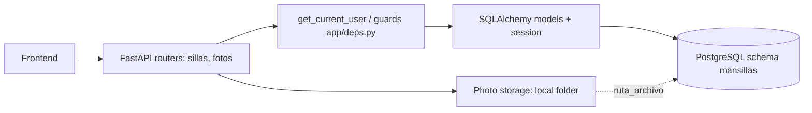

# Design Document

## Overview

This feature extends the existing Mansillas SIC backend to close two gaps in the field-survey flow, built on the current FastAPI + SQLAlchemy + PostgreSQL (`mansillas` schema) stack with no new architectural layers:

- **HU-02** — expose a read endpoint that returns the chairs of a visit so the real count (Cantidad_Real) can be derived, while chair registration beyond the estimate stays as already implemented.
- **HU-10** — attach multiple photographs to a chair and consult them, reusing the existing `fotografia` table (`id_fotografia`, `id_silla`, `ruta_archivo`, `fecha_subida`).

No schema change, no second registration mechanism, no component evaluation (Esteban's module), no image processing, and no public exposure of photographs.

## Architecture

The request flow mirrors the existing backend: router → `get_current_user` + role/ownership guard (`app/deps.py`) → SQLAlchemy session (`get_db`) → existing `mansillas` tables. Photographs add one step: the file bytes are written to the chosen storage and the returned location is saved in `fotografia.ruta_archivo`.



## Existing functionality reused

- **Chair registration** `POST /visitas/{id_visita}/sillas` in `app/routers/sillas.py` — already creates chairs without comparing against `cantidad_estimada` (HU-02 Requirement 1). Not modified.
- **`cantidad_estimada` preservation** — `app/routers/visitas.py` already drops `cantidad_estimada` on visit update (RN-04). Not modified.
- **Business RBAC** `app/deps.py` — `get_current_user`, `require_role`, `require_tecnico_owns_visita`, and the chair authorization helper `_autorizar_silla` pattern already used in `sillas.py`.
- **`Silla` model and `SillaOut` schema** `app/models/silla.py`, `app/routers/sillas.py` — reused as the response shape for the chairs listing.
- **Session/engine** `app/db.py` (`get_db`), config `app/config.py`.

## Module / File Structure

```
backend/app/
├── main.py                 # MODIFY: include the fotos router
├── config.py               # MODIFY: add photo_storage_dir (default var/fotos/), photo_max_bytes (10 MB), photo_allowed_formats (JPEG/PNG/WEBP)
├── models/
│   ├── __init__.py         # MODIFY: export Fotografia
│   └── fotografia.py       # NEW: Fotografia model (existing table, no schema change)
├── services/
│   └── fotos_storage.py    # NEW: validate (Pillow), store with UUID name, resolve/delete safely
└── routers/
    ├── sillas.py           # MODIFY: add GET /sillas?id_visita= (chairs listing)
    └── fotos.py            # NEW: POST/GET /sillas/{id_silla}/fotos
```

Chair listing is added to the existing `sillas.py` to keep chair endpoints together. Photographs get their own `fotos.py` router following the `sillas.py` pattern (thin router, inline Pydantic schemas, `IntegrityError`/error → `HTTPException`).

## Data Models

Both tables already exist; no schema change. Only the columns used are listed.

| Table | Columns used | Notes |
|-------|--------------|-------|
| `silla` | `id_silla`, `id_empresa`, `id_visita`, `id_sede`, `id_departamento`, `id_empleado`, `cargo`, `numero_qr`, `codigo_qr`, `token_publico`, `serial_antiguo`, `observaciones`, `estado`, `fecha_registro` | Listed for a visit. Cantidad_Real = count of rows with a given `id_visita`; never stored. |
| `visita` | `id_visita`, `id_empresa`, `id_tecnico`, `cantidad_estimada` | Existence and ownership check; `cantidad_estimada` preserved. |
| `fotografia` | `id_fotografia`, `id_silla`, `ruta_archivo`, `fecha_subida` | `id_fotografia` identity; `fecha_subida` default `CURRENT_TIMESTAMP`. No `nombre_archivo` column. |

New model `app/models/fotografia.py` (mirrors the existing model style; identity PK and `fecha_subida` marked `FetchedValue()`):

```python
class Fotografia(Base):
    __tablename__ = "fotografia"
    __table_args__ = {"schema": settings.db_schema}

    id_fotografia: Mapped[int] = mapped_column(BigInteger, primary_key=True)
    id_silla: Mapped[int] = mapped_column(BigInteger, nullable=False)
    ruta_archivo: Mapped[str] = mapped_column(Text, nullable=False)
    fecha_subida: Mapped[datetime] = mapped_column(
        DateTime, nullable=False, server_default=FetchedValue()
    )
```

## Components and Interfaces

All endpoints depend on `get_current_user` (`app/deps.py`). "Role" is the required `rol` literal.

| Method | Path | Role | Request | Response |
|--------|------|------|---------|----------|
| GET | `/sillas?id_visita={id}` | COMERCIAL (any) / TECNICO (own visit) | query `id_visita` (required) | `200` list of `SillaOut`; `401`; `403`; `404` unknown visit; `422` missing param |
| POST | `/sillas/{id_silla}/fotos` | TECNICO (owns chair's visit) | `multipart/form-data`, field `archivo` (one image) | `201` `FotografiaOut`; `400` invalid content; `401`; `403`; `404`; `413` too large; `422` missing file; `500` storage failure |
| GET | `/sillas/{id_silla}/fotos` | COMERCIAL (any) / TECNICO (own visit) | — | `200` list of `FotografiaOut`; `401`; `403`; `404` |
| GET | `/sillas/{id_silla}/fotos/{id_fotografia}` | COMERCIAL (any) / TECNICO (own visit) | — | `200` image stream; `401`; `403`; `404` (unknown photo, not of this chair, or stored file missing); `500` unexpected read failure |

Response shapes:

- `SillaOut` — the existing schema in `sillas.py` (includes `id_silla`, `id_visita`, `codigo_qr`, `token_publico`, `estado`, `fecha_registro`, `serial_antiguo`, `observaciones`, …). Matches the fields the frontend `listSillas` consumes. Component/`sugerir_cambio` fields are Esteban's and are out of scope.
- `FotografiaOut` — `{id_fotografia, id_silla, ruta_archivo, nombre_archivo, fecha_subida}`. This matches the object the frontend `uploadFotoSilla` consumes (confirmed read-only against `origin/dev/nicolas`: multipart field name `archivo`, response fields `id_fotografia`, `ruta_archivo`, `nombre_archivo`, `fecha_subida`). `nombre_archivo` is **not** a schema column: it is **always** derived from the **stored** filename (the UUID name, e.g. `{uuid}.jpg`) in both POST and GET, so the same photo returns the same consistent value. The original client filename is not persisted and is not guaranteed to be recoverable. `ruta_archivo` is the stored relative path.

The chairs listing requires the `id_visita` query parameter: it answers "the chairs of a visit" (HU-02). A missing/empty `id_visita` is a client error (`422`).

Image retrieval (Requirement 4.2) is served by `GET /sillas/{id_silla}/fotos/{id_fotografia}`, which streams the file through the same authorization as reading the chair, only when the photo's `id_silla` matches the `id_silla` in the URL (else `404`). No static public path is exposed.

**Frontend retrieval contract (no frontend change here):** the existing `apiClient` attaches `Authorization: Bearer <jwt>` to every request. A browser `` does **not** send that header, so the image endpoint is meant to be fetched through `apiClient` as a binary blob (`responseType: 'blob'`) and shown via an object URL, the same way the frontend already handles authenticated downloads. The backend contract is: authenticated `GET .../fotos/{id_fotografia}` → the image bytes with the correct image media type. This is documented for the frontend owner; no frontend code is modified.

## Key Decisions

### Photo storage

**Decision:** store photo files in a **local folder** configured by env var `PHOTO_STORAGE_DIR` (default `var/fotos/`, resolved relative to the backend root `BACKEND_DIR` consistently with `app/config.py`), saving the **relative** path in `fotografia.ruta_archivo`. A single mechanism, no provider abstraction.

**Justification (simplest option sufficient for the MVP):** the `fotografia` table already stores a path (`ruta_archivo`), not bytes, so a filesystem fits directly. A local folder needs no extra dependency, credentials, or network call, and the backend runs as a single process. This is the simplest option that satisfies HU-10. The folder is not mounted as a static public route; files are served only through the authorized retrieval endpoint, and a resolved path is verified to stay inside `PHOTO_STORAGE_DIR` (reject otherwise) to prevent traversal. Stored photos are excluded from version control (`.gitignore`).

**Deployment assumption and limitation:** this assumes the deployment host provides **persistent** disk for `PHOTO_STORAGE_DIR`. The target pilot host is not yet confirmed. If the host has **ephemeral** storage (e.g. Render/Railway default filesystems), stored files would be lost on redeploy/restart, so persistence must be verified before deployment. Switching to Supabase Storage later is **not** a configuration-only change: it would require adapting the internal storage operations (write, retrieve, delete), although the API contracts (endpoints and `ruta_archivo`) could be preserved. Supabase Storage is **not** implemented in this stage. Local development is not blocked by the pending host confirmation.

### File validation

- Accepted types: **JPEG, PNG, WebP**. Max size: **10 MB** per photo (MVP technical decisions, not official acceptance criteria). A file over the limit is rejected with `413`.
- The upload is read with a hard cap of **`photo_max_bytes + 1`** bytes; if that many bytes are read, the file exceeds the limit and is rejected with `413` before any decoding.
- Validation is on the **real content**, not only the extension, the `Content-Type`, or the initial signature: the bytes are opened with **Pillow** (`PIL.Image.open` then `verify()`, reusing the `qrcode[pil]` dependency already installed) to confirm a valid, non-corrupt JPEG/PNG/WebP and to read the real format. A corrupt or non-image file is rejected with `400` and no row/file is created. Pillow's decompression-bomb protection (`MAX_IMAGE_PIXELS`) is left enabled, and both its `DecompressionBombWarning` and `DecompressionBombError` are treated as **validation failures** (`400`). No further processing, compression, or thumbnails are done.

### Unique, safe storage names

- Stored filename is a server-generated **UUID** plus the validated extension (e.g. `{uuid4}.jpg`), never the client-supplied name, avoiding path traversal and collisions. `nombre_archivo` in the response is derived from this **stored** filename (the UUID name), consistently in both POST and GET; the original client filename is not persisted.

### Storage ↔ database consistency

Single-process compensation, no distributed atomicity, no queues and no extra recovery processes:

1. Validate the file (type, size, content). On failure → `400`/`413`, nothing written.
2. Write the file to storage with its UUID name. IF the write fails → reject with `500`, leaving no partial file where possible (write then rename, or delete the partial on error).
3. Insert the `fotografia` row and commit.
4. IF the commit fails with a **confirmed** pre-commit error (the transaction definitely did not commit) → roll back and attempt to delete the just-written file, so neither the file nor the row remains; the error surfaces as `500`. IF the compensating delete fails → log it (the file may be orphaned; acceptable for the MVP and recorded for cleanup).
5. IF the commit outcome is **uncertain** (a connection-level error during COMMIT, `DBAPIError.connection_invalidated`) → do NOT delete the file, because the row may already be persisted; keeping the file avoids orphaning a committed row. The error still surfaces as `500` and the situation is logged. This residual case is accepted without distributed transactions or extra recovery.
6. Any error AFTER a successful commit (e.g. response serialization) never deletes the file.

## Flows

**Register photo (`POST /sillas/{id_silla}/fotos`):** resolve current user → load chair (`404` if missing) → authorize: must be `TECNICO` owning the chair's visit, else `403` → validate the `archivo` field: missing field → `422`; over the size limit → `413`; invalid/corrupt content → `400` → store file with UUID name → insert `fotografia` row → on DB failure compensate (delete file) → `201` `FotografiaOut`.

**List photos (`GET /sillas/{id_silla}/fotos`):** resolve user → load chair (`404`) → authorize read (same rules as reading the chair: `COMERCIAL_MANSILLAS` any, `TECNICO` own visit, else `403`) → return all `fotografia` rows for `id_silla` (empty list if none).

**Retrieve image (`GET /sillas/{id_silla}/fotos/{id_fotografia}`):** resolve user → load chair + photo (`404` if either missing or photo not of this chair) → authorize read → resolve the stored path safely; if the physical file does not exist → `404`; stream the stored file with its image media type; an unexpected read error → `500`.

**List chairs (`GET /sillas?id_visita=`):** resolve user → load visit (`404` if missing) → authorize: `COMERCIAL_MANSILLAS` any, `TECNICO` only own visit, else `403` → return all `silla` rows of the visit (empty list if none). Cantidad_Real = length of the returned list.

## Authorization and error handling

Authorization reuses `app/deps.py`. Chair-photo access reuses the existing chair-authorization rule (`_autorizar_silla`): commercial reads any, technician only within owned visits; uploads are technician-owner only.

| Condition | Status | Body |
|-----------|--------|------|
| Missing/empty `id_visita`, or missing multipart `archivo` field | `422` | identifies the missing parameter/field |
| Unauthenticated request (no valid session) | `401` | resolved by existing `get_current_user`; `WWW-Authenticate: Bearer` |
| File not an accepted image type, or corrupt image content | `400` | `{detail: "Archivo inválido"}` |
| File over the 10 MB size limit | `413` | `{detail: "La fotografía supera el tamaño permitido"}` |
| Wrong role for the endpoint | `403` | `{detail: "Rol no autorizado"}` |
| Technician acting outside own visit | `403` | `{detail: "No autorizado para esta visita"}` |
| Unknown visit / chair / photo, photo not of the chair in the URL, or stored file missing on disk | `404` | `{detail: "No encontrado"}` |
| File write fails, DB insert fails after file stored, or unexpected read error | `500` | generic message, no internal detail; file write/removal compensated, failures logged |

`401` comes from the existing `get_current_user` dependency (unchanged); no global exception handler is added and no external security module is modified. No stored file is reachable through a path that bypasses these checks; photographs are not added to the public `GET /sillas/token/{token}` endpoint.

## Testing Strategy

Proportional to the MVP and tied to the acceptance criteria. Tests reuse the existing `tests/conftest.py` fixtures (`cliente`, `fabrica`, `auth`) and run against an **isolated, disposable** PostgreSQL (`TEST_DATABASE_URL`); they must not touch the shared Supabase database. Integration tests that need that database are **documented as pending execution** until an isolated instance is available.

- **HU-02 chairs listing** (`tests/test_sillas.py`, extend):
  - listing returns all chairs of a visit; count matches registered (Req 2.1/2.2).
  - existing visit with no chairs → empty list (Req 2.3).
  - unknown visit → `404` (Req 2.4).
  - technician on a foreign visit → `403`; commercial on any visit → `200`; other role → `403` (Req 2.5/2.6/2.7).
  - reuse `test_sillas_no_se_limitan_por_cantidad_estimada` for Req 1 (already present; execution pending).
- **HU-10 photos** (new `tests/test_fotos.py`). Storage tests point `PHOTO_STORAGE_DIR` at a pytest `tmp_path` so no real folder is touched:
  - upload one photo → `201`, row linked to chair; two uploads → two rows for the same chair (Req 3.1/3.2).
  - missing file → `422`; non-image / corrupt content → `400`, no row (Req 3.3).
  - file over 10 MB → `413`, no row.
  - valid extension but invalid/corrupt content → `400`, no row.
  - file write failure → `500`, no row and no partial file (Req 3.8).
  - unknown chair → `404` (Req 3.4).
  - non-owner technician / wrong role upload → `403`, no row (Req 3.5).
  - list returns all photos, empty when none (Req 4.1/4.3); retrieve streams the image bytes (Req 4.2).
  - retrieve a photo whose `id_fotografia` belongs to a different chair than the URL's `id_silla` → `404`.
  - retrieve a photo whose physical file is missing on disk → `404`.
  - direct retrieval without authorization (wrong role / foreign technician / unauthenticated) → `403`/`401` (Req 4.5).
  - unknown chair on query → `404` (Req 4.6).
  - photographs absent from the public token endpoint (Req 4.7).
  - consistency: simulate a DB failure after the file write and assert no row and no leftover file (Req 3.6); simulate a failing compensating delete and assert the failure is logged (Req 3.7). Verified by a focused unit test of the storage/rollback helper where it can run in isolation.

Features verified only by code inspection (not executed) are reported as such; a feature is not declared validated on code appearance alone. Integration tests needing the isolated PostgreSQL stay pending execution until a safe instance is available; destructive tests against the shared Supabase database are prohibited.

## Traceability

| Requirement | Design element |
|-------------|----------------|
| R1 (register beyond estimate; preserve `cantidad_estimada`) | Existing `POST /visitas/{id_visita}/sillas` and visit-update drop of `cantidad_estimada`; reused, not modified |
| R2 (consult real chairs; empty; 404; auth; no redundant counter) | `GET /sillas?id_visita=` in `sillas.py`; count derived from list |
| R3 (upload multiple photos; validation; auth; consistency; logging) | `POST /sillas/{id_silla}/fotos`, `fotos.py`; validation + UUID name + compensation |
| R4 (consult photos; effective retrieval; empty; auth; 404; no public bypass) | `GET /sillas/{id_silla}/fotos` and `GET .../fotos/{id_fotografia}` stream |
| R5 (reuse schema/auth; single storage mechanism) | New `Fotografia` model over existing table; `app/deps.py`; local-folder storage decision |
