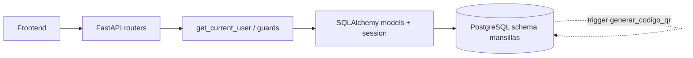

# Design Document

## Overview

The Mansillas SIC backend is a FastAPI service that consumes the **existing** PostgreSQL schema `mansillas` hosted on Supabase, connecting through SQLAlchemy with the `postgresql+psycopg` driver. It does **not** redesign the schema: tables, the `secuencia_qr` sequence, and the `generar_codigo_qr` trigger already exist and are reused as-is.

The layout is intentionally simple: one SQLAlchemy model per table, one router module per resource, a single engine/session module, and a dependency module for the current user. No repositories, services layers beyond two small helpers, caches, queues, or microservices.

Scope of this module: visits, chairs (+ QR codes and public tokens), QR label PDFs, and pre-quotation access logging. Authentication and the pre-quotation record itself belong to teammates and are referenced only by contract.

## Architecture

FastAPI handles HTTP; SQLAlchemy (driver `postgresql+psycopg`) maps the existing `mansillas` tables; PostgreSQL on Supabase owns the sequence and triggers. Requests flow: router → `get_current_user` dependency + role/ownership guard → SQLAlchemy session (`get_db`) → existing tables. QR codes and public tokens are produced by the database (trigger + column default), not by the backend.



## Module / File Structure

```
backend/app/
├── main.py                 # FastAPI app, include_router for each resource
├── db.py                   # engine (postgresql+psycopg), SessionLocal, Base, get_db
├── deps.py                 # get_current_user dependency (+ dev stub), role guards
├── config.py               # reads DATABASE_URL, FRONTEND_URL from env
├── models/
│   ├── __init__.py
│   ├── empresa.py          # Empresa
│   ├── sede.py             # Sede
│   ├── departamento.py     # Departamento
│   ├── usuario.py          # Usuario
│   ├── empleado.py         # Empleado
│   ├── visita.py           # Visita
│   ├── silla.py            # Silla
│   ├── precotizacion.py    # Precotizacion (reference only, owned by teammate)
│   └── acceso.py           # AccesoPrecotizacion
└── routers/
    ├── visitas.py          # /visitas CRUD
    ├── sillas.py           # chair registration + read/update, get_silla_by_token
    ├── qr.py               # /qr/pdf label generation
    └── accesos.py          # access log read + registrar_acceso service
```

`db.py` builds the engine with `connect_args` setting `options=-c search_path=mansillas` (or `__table_args__ = {"schema": "mansillas"}` on models) so SQLAlchemy targets the `mansillas` schema. All models declare `schema="mansillas"`.

`deps.py` exposes `get_current_user() -> CurrentUser(id, rol, empresa_id)`. In dev it returns a configurable stub; in production it delegates to the auth teammate's resolver. Small guard helpers (`require_role`, `require_tecnico_owns_visita`) live here.

## Data Models

The data models are the **existing** `mansillas` tables, mapped one SQLAlchemy model per table (no schema changes). Only columns relevant to this module are listed.

### Tables Used (existing schema — not modified)

Only columns relevant to this module are listed.

| Table | Columns used | Notes |
|-------|--------------|-------|
| `empresa` | `id_empresa` | Ownership scoping. |
| `sede` | `id_sede`, `id_empresa` | Composite FK target for visit/chair. |
| `departamento` | `id_departamento`, `id_empresa`, `id_sede` | Derived for a chair via empleado. |
| `usuario` | `id_usuario`, `rol` | `id_comercial`, `id_tecnico` on a visit. |
| `empleado` | `id_empleado`, `id_empresa`, `id_sede`, `id_departamento`, `cargo` | Source of a chair's empresa/sede/departamento. |
| `visita` | `id_visita`, `id_empresa`, `id_sede`, `id_comercial`, `id_tecnico`, `fecha_programada`, `cantidad_estimada`, `estado`, `observaciones` | `cantidad_estimada` is set once at creation and never rewritten (RN-04). |
| `silla` | `id_silla`, `id_empresa`, `id_visita`, `id_sede`, `id_departamento`, `id_empleado`, `cargo`, `numero_qr`, `codigo_qr`, `token_publico`, `serial_antiguo`, `observaciones` | `codigo_qr` filled by trigger; `token_publico` default `gen_random_uuid()`. |
| `secuencia_qr` (SEQUENCE) + `generar_codigo_qr` (TRIGGER) | — | Produce `SIC-00000001`. Backend never computes the code. |
| `precotizacion` | `id_precotizacion`, `id_empresa` | **Owned by another teammate**; referenced by id only, never written here. |
| `acceso_precotizacion` | `id_acceso`, `id_precotizacion`, `fecha_acceso`, `ip`, `navegador`, `sistema_operativo` | Written by `registrar_acceso`, read by the access-log endpoint. |

## Components and Interfaces

The components are the four router modules plus two internal service functions. The HTTP contract each router exposes is listed below; the two service functions follow the table.

All authenticated endpoints depend on `get_current_user`. "Role" is the required `rol` literal.

| Method | Path | Role | Request | Response |
|--------|------|------|---------|----------|
| POST | `/visitas` | COMERCIAL | `{id_empresa, id_sede, id_tecnico, cantidad_estimada, fecha_programada?, observaciones?}` | `201` Visita |
| GET | `/visitas` | COMERCIAL (all) / TECNICO (own) | — | `200` list of Visita |
| GET | `/visitas/{id}` | COMERCIAL (any) / TECNICO (own) | — | `200` Visita / `403` / `404` |
| PUT | `/visitas/{id}` | COMERCIAL | `{id_sede?, id_tecnico?, fecha_programada?, estado?, observaciones?}` (no `cantidad_estimada`) | `200` Visita |
| DELETE | `/visitas/{id}` | COMERCIAL | — | `204` |
| POST | `/visitas/{id_visita}/sillas` | TECNICO (own visit) | `{id_empleado, cargo, serial_antiguo?, observaciones?}` | `201` `{id_silla, id_empresa, id_sede, id_departamento, id_empleado, cargo, codigo_qr, token_publico}` |
| GET | `/sillas/{id}` | COMERCIAL (any) / TECNICO (own visit) | — | `200` `{id_empresa, id_sede, id_departamento, id_empleado, cargo, serial_antiguo, observaciones, codigo_qr, token_publico}` |
| PUT | `/sillas/{id}` | TECNICO (own visit) | `{serial_antiguo?, observaciones?}` | `200` Silla / `409` duplicate serial |
| POST | `/qr/pdf` | TECNICO (own) / COMERCIAL (any) | `{ids: [id_silla, ...]}` | `200` `application/pdf` |
| GET | `/precotizaciones/{id}/accesos` | COMERCIAL | — | `200` list of Acceso / `200` `{mensaje: "Sin accesos registrados"}` |

Internal (not HTTP endpoints, called by teammates):

- `get_silla_by_token(db, token) -> Silla | None` — used by the public chair-view teammate. Returns the public query fields for a valid `token_publico`, `None` otherwise.
- `registrar_acceso(db, precotizacion_id, user_agent) -> AccesoPrecotizacion` — parses the User-Agent into `navegador` / `sistema_operativo` and inserts one `acceso_precotizacion` row. Called by the pre-quotation public endpoint teammate.

## Key Decisions

- **QR code (`codigo_qr`)** — the backend inserts a chair with `codigo_qr = ''` (or omits it / sets `NULL`). The existing `BEFORE INSERT` trigger `generar_codigo_qr` fills it as `SIC-` + 8-digit zero-padded `numero_qr`, where `numero_qr` defaults to `nextval('secuencia_qr')`. The sequence is monotonic, so a code is never reused even after a chair is deleted. The backend reads the assigned `codigo_qr` back (via `RETURNING` / refresh) to return it. It never constructs the code itself.
- **Public token (`token_publico`)** — left to the column default `gen_random_uuid()`; a random UUID with no relation to `codigo_qr` or `id_silla`. The QR image encodes a public URL `{FRONTEND_URL}/silla/{token_publico}` only — never personal data.
- **PDF generation** — `qrcode` to render each QR (error correction level `H`) and `reportlab` to compose a grid on the page. Each module is drawn at ≥ 3 cm × 3 cm with the `codigo_qr` printed below it. Target: a batch of 50 completes in ≤ 20 s (QR images generated in-loop, single PDF stream). Returned as a streaming `application/pdf` response.
- **Legacy serial (`serial_antiguo`)** — uniqueness is enforced by the existing DB constraint `UNIQUE (id_empresa, serial_antiguo)`. On insert/update the backend catches SQLAlchemy `IntegrityError`, rolls back, and returns `409` without creating or mutating the chair. No pre-check SELECT (avoids a race).
- **Role & ownership enforcement** — every endpoint validates the `rol` literal first. Technician endpoints additionally verify the target visit's `id_tecnico == current_user.id` (and for chair reads, the chair's visit). Mismatch → `403`.

## Integration / Contact Points

- **Auth teammate** → provides `get_current_user`; this module imports the dependency and the `CurrentUser(id, rol, empresa_id)` shape. A dev stub lives in `deps.py` until the real resolver lands.
- **Pre-quotation teammate** → owns the `precotizacion` table. This module reads `id_precotizacion` only (for the access log) and never inserts/updates it.
- **Public chair-view teammate** → calls `get_silla_by_token(token)`; contract is "valid token → public fields, unknown token → None".
- **Pre-quotation public endpoint teammate** → calls `registrar_acceso(precotizacion_id, user_agent)` to log an access.

## Error Handling

| Condition | Status | Body |
|-----------|--------|------|
| Missing/invalid required fields | `422` (FastAPI) or `400` | lists the offending fields |
| Duplicate `serial_antiguo` within empresa | `409` | `{detail: "serial_antiguo duplicado para la empresa"}` |
| Technician accessing another technician's visit/chair | `403` | `{detail: "No autorizado para esta visita"}` |
| Wrong role for the endpoint | `403` | `{detail: "Rol no autorizado"}` |
| Unknown visit / chair / token | `404` | `{detail: "No encontrado"}` |

`IntegrityError` from the duplicate-serial constraint is caught in the router, the session is rolled back, and the `409` is raised so no partial row remains.

## Testing Strategy

Minimal and focused on the three critical business rules. Property tests run ≥ 100 iterations against a test database; each test is tagged with its design property.

- **Unit/example tests** cover happy paths and the error table (missing fields → 422, foreign visit → 403, unknown id → 404, token round-trip, UA parsing).
- **Property tests** cover the three rules below.

## Correctness Properties

*A property is a characteristic or behavior that should hold true across all valid executions of a system — a formal statement about what the system should do. Properties serve as the bridge between human-readable specifications and machine-verifiable correctness guarantees.*

### Property 1: QR codes are never reused

*For any* sequence of chair creations — including creations that follow deletions of earlier chairs — every assigned `codigo_qr` is unique across all chairs ever created, and the underlying `numero_qr` values are strictly increasing in creation order (the sequence is never rolled back or reassigned).

**Validates: Requirements 4.1, 4.2**

### Property 2: Duplicate legacy serials are rejected per empresa

*For any* empresa and any `serial_antiguo` value already stored for a chair in that empresa, a subsequent attempt to create or update a chair with the same `(id_empresa, serial_antiguo)` pair is rejected with a `409` and leaves the chair count and existing chair unchanged; the same serial in a different empresa succeeds.

**Validates: Requirements 5.2**

### Property 3: A technician sees only their own visits

*For any* set of visits distributed among arbitrary technicians, the visit list returned to a technician contains every visit whose `id_tecnico` equals that technician's identifier and no visit assigned to any other technician.

**Validates: Requirements 2.1, 2.2**
