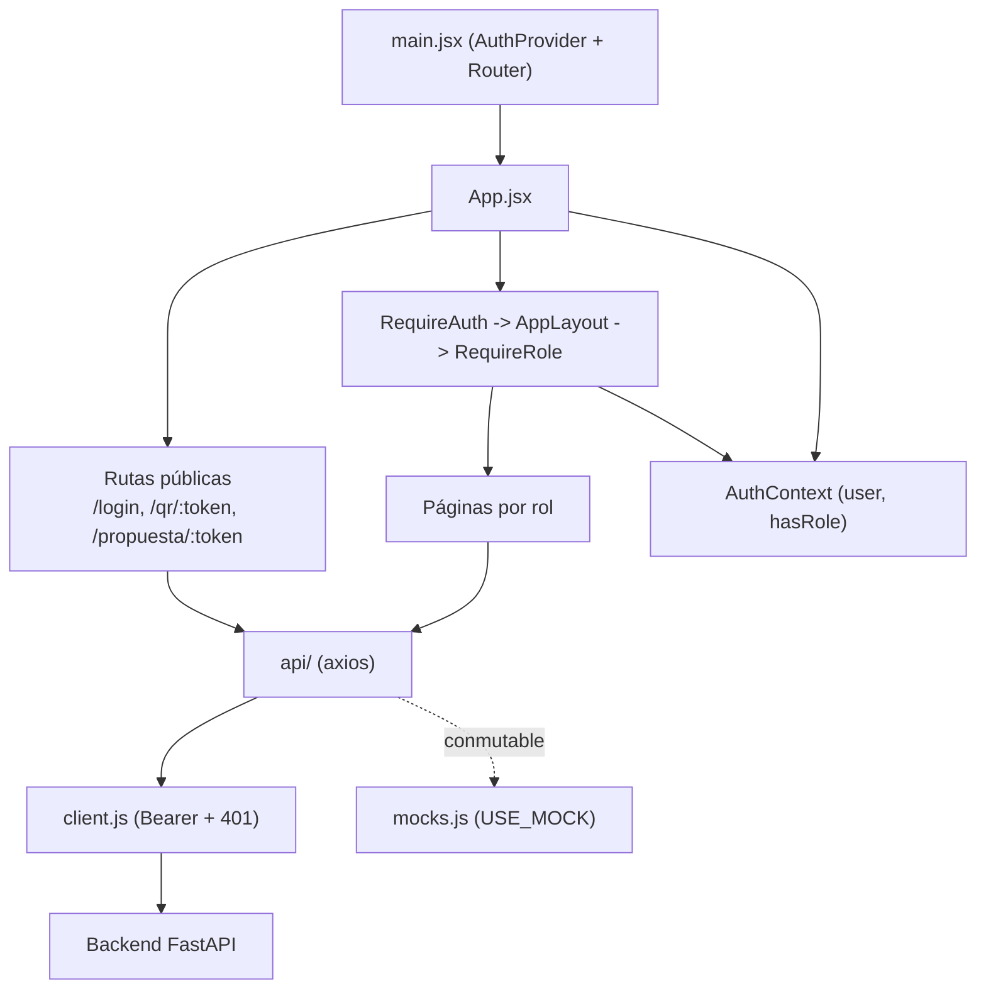

# Mansillas SIC — Frontend

SPA en **React 19 + Vite 8** que consume la API del
[backend FastAPI](../backend/README.md). Implementa la interfaz de todos los
roles del sistema, impone RBAC en la navegación (espejo del control real del
backend) y expone dos vistas públicas sin login: la ficha de una silla por QR y
la aceptación de una precotización por enlace + OTP.

> **Documentación relacionada**
> - Arquitectura y diagramas: [`../ARCHITECTURE.md`](../ARCHITECTURE.md)
> - API del backend: [`../backend/README.md`](../backend/README.md)
> - Estado de integración frontend ↔ backend: [`docs/INTEGRACION_ENDPOINTS.md`](docs/INTEGRACION_ENDPOINTS.md)
> - Despliegue: [`../DEPLOY.md`](../DEPLOY.md)

## Stack

| Área | Tecnología |
| --- | --- |
| UI | React 19 |
| Bundler / dev server | Vite 8 |
| Enrutado | react-router-dom 7 |
| HTTP | axios |
| Lectura/escritura de Excel | xlsx (carga masiva de empleados) |
| Lint | oxlint |

## Requisitos

- Node.js 20+ (recomendado por Vite 8)
- npm

## Puesta en marcha

```bash
cd frontend
npm ci
npm run dev
```

El servidor de desarrollo queda en `http://localhost:5173`. Necesita el backend
corriendo en `VITE_API_URL` (por defecto `http://127.0.0.1:8000`).

### Scripts

| Script | Acción |
| --- | --- |
| `npm run dev` | Servidor de desarrollo con HMR |
| `npm run build` | Compila a estático en `dist/` |
| `npm run preview` | Sirve el build de `dist/` para verificación |
| `npm run lint` | Ejecuta oxlint |

## Variables de entorno

Las variables `VITE_*` se incrustan en el **build**, no en tiempo de ejecución:
tras cambiarlas hay que recompilar. Copia `.env.example` a `.env.local` para
desarrollo.

| Variable | Obligatoria | Valor / nota |
| --- | --- | --- |
| `VITE_API_URL` | Sí (en despliegue) | URL del backend, sin barra final. Por defecto `http://127.0.0.1:8000` |
| `VITE_INACTIVITY_MINUTES` | No | Minutos de inactividad antes del logout en UI. Por defecto `30`, en coherencia con `SESSION_INACTIVITY_MINUTES` del backend |

## Estructura del proyecto

```
frontend/src/
├── main.jsx            # Punto de entrada: AuthProvider + Router
├── App.jsx             # Definición de rutas (públicas y privadas con RBAC)
├── pages/              # Una página por vista de negocio
├── components/         # Componentes reutilizables (layout, secciones, cards)
├── api/                # Capa HTTP (axios) por recurso + mocks conmutables
├── auth/               # Guards (RequireAuth, RequireRole), roles, inactividad
├── context/            # AuthContext + useAuth
├── utils/              # Utilidades (descargar blob, parsear Excel)
├── styles/             # Estilos
└── assets/             # Recursos estáticos
```

### Páginas

| Página | Propósito |
| --- | --- |
| `LoginPage` | Inicio de sesión por correo/contraseña |
| `HomeRedirect` | Redirige a la vista inicial según el rol |
| `UsuariosPage` | Gestión de usuarios y roles (COMERCIAL) |
| `EmpresasPage` | Alta de empresas, sedes, departamentos y empleados |
| `VisitasPage` | Programación y gestión de visitas |
| `LevantamientoPage` | Levantamiento en campo (móvil): sillas, componentes, fotos |
| `PortalComercialPage` | Revisión del levantamiento y precotizaciones |
| `PortalClientePage` | Portal de solo lectura del ADMIN_CLIENTE |
| `QrPublicoPage` | Ficha pública de la silla (vía QR, sin login) |
| `PropuestaPublicaPage` | Consulta y aceptación de la propuesta (enlace + OTP) |
| `NotFoundPage` | 404 |

## Rutas y RBAC

El RBAC del frontend solo **oculta** lo que no corresponde al rol; la
autorización real la impone el backend (`401`/`403`). Las rutas públicas quedan
fuera de `RequireAuth`; las privadas van detrás de `RequireAuth` y, cuando
aplica, de `RequireRole`.

| Ruta | Página | Acceso |
| --- | --- | --- |
| `/login` | `LoginPage` | Público |
| `/qr/:token` | `QrPublicoPage` | Público (token del QR) |
| `/propuesta/:token` | `PropuestaPublicaPage` | Público (enlace + OTP) |
| `/` | `HomeRedirect` | Autenticado |
| `/usuarios` | `UsuariosPage` | COMERCIAL_MANSILLAS |
| `/empresas` | `EmpresasPage` | COMERCIAL_MANSILLAS |
| `/visitas` | `VisitasPage` | COMERCIAL, TECNICO, ADMIN_CLIENTE |
| `/levantamiento` | `LevantamientoPage` | TECNICO, COMERCIAL |
| `/comercial` | `PortalComercialPage` | COMERCIAL_MANSILLAS |
| `/cliente` | `PortalClientePage` | ADMIN_CLIENTE |

### Sesión e inactividad

- **`AuthContext` / `useAuth`**: guarda el usuario y su rol, rehidrata la sesión
  desde `localStorage` al arrancar, y expone `signIn`, `signOut` y `hasRole`.
- **`RequireAuth`**: redirige a `/login` sin sesión.
- **`RequireRole`**: muestra "Acceso denegado" si el rol no está permitido.
- **`useInactivityLogout`**: cierra sesión tras `VITE_INACTIVITY_MINUTES` sin
  actividad. Es solo UX: el backend ya expira la sesión y responde `401`.

## Capa `api/` y mocks conmutables

Todas las llamadas HTTP pasan por `src/api/`. El cliente compartido
(`api/client.js`) añade el JWT como `Authorization: Bearer` y, ante un `401` que
no venga de `/auth/login`, limpia la sesión y redirige a `/login`. Las vistas
públicas (`qr-publico.js`, `propuesta.js`) usan un cliente anónimo sin token ni
redirección.

`src/api/mocks.js` define una bandera `USE_MOCK.<recurso>` por recurso: en `true`
usa datos simulados; en `false` consume el endpoint real. Esto permitió avanzar
en las pantallas mientras el backend crecía. **Estado actual: todas las banderas
están en `false`**, de modo que la aplicación consume por completo el backend
real.

El seguimiento histórico del cableado está en
[`docs/INTEGRACION_ENDPOINTS.md`](docs/INTEGRACION_ENDPOINTS.md) (describe una
fase intermedia de integración; el estado vigente es el de este README).

## Componentes del frontend



Detalle y flujos de secuencia en
[`../ARCHITECTURE.md`](../ARCHITECTURE.md#7-arquitectura-del-frontend).

## Despliegue

Proyecto Vite/React; se compila a estático (`dist/`). Guía completa en
[`../DEPLOY.md`](../DEPLOY.md):

- Build: `npm ci && npm run build`
- Carpeta publicada: `dist`
- Configurar `VITE_API_URL` con la URL pública del backend y **recompilar**.
